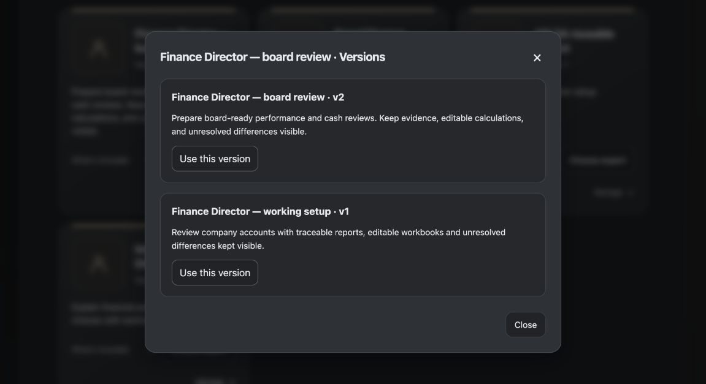

# Changelog

From GlassHive's first retained source snapshot to xPerfect today. These are dated development
milestones, not versioned release announcements. Related fixes are grouped by their benefit to
users and builders; internal merges, test-only changes and dependency housekeeping are omitted.

GlassHive entries describe the predecessor at that time, not a promise of current support.
The [capability guide](docs/capability-matrix.md) owns today's availability and limits.
xPerfect is licensed under [Apache 2.0](LICENSE); this does not change GlassHive's historical license.

[Visual user guide](https://www.xperfect.ai/docs/) · [Website changelog](https://www.xperfect.ai/changelog/)

## 2026-10-25 — Keep your best experts. Stay in control.

> **Summary:** Save a successful worker as a reusable expert, refine its setup and return to the exact version you need. New work controls, clearer usage and recoverable desktops make ongoing work easier to manage.
>
> **Example:** Turn a useful Finance Director setup into your company’s reusable expert. Try a revision, return to an earlier version, and pause new assignments while keeping existing results.
>
> **Topics:** Experts, Work control, Connections, Deployment, Reliability

> **Image caption:** Expert gallery, captured 25 October 2026: five packaged AI Workers and Create.

> **Image caption:** Actual Versions dialog with a synthetic Finance Director setup, 25 October 2026.

- **Benefit:** Reuse expertise: edit, copy, archive, restore and choose exact expert versions without changing workers already doing a job.
- **Benefit:** Keep control: inspect reported usage, pause new assignments for your account or a project, and resume the same queue.
- **Benefit:** Install more easily: xPerfect selects the matching package for your computer or Linux server.

- **Improved:** Public guides now show how to schedule an AI job or send a webhook, with practical app recipes and clear delivery checks. A source-linked comparison explains what xPerfect adds to native tools and its current limits.
- **Improved:** The README and guide use the real brand mark, the current expert gallery and consistent package guidance. Obsolete UI/QA captures were removed from publication; retained result images keep their actual synthetic-work scope.

- **Added:** Owner and project work pauses with explicit Resume. Optional spending policies use reported money and explicit reserves when costs are unknown. Existing active work is preserved; resuming wakes the existing queue.
- **Improved:** Watch, HTTP and MCP retain exact-attempt usage and safe provider failure provenance. Missing usage stays unknown, reported zero stays zero, and repeated receipts do not add the same charge again.
- **Added:** Claude Code connections can use Amazon Bedrock with their own region, protected credentials and declared model choices. Provider access still requires the owner's AWS permissions; a saved setup is not an authenticated model test.
- **Added:** An optional evidence kit for immutable inputs, independent result checks, terminal-evidence export and marker-last delivery. Retained outputs can be delivered again without another model call. It adds no runtime dependency or application-specific queue.
- **Improved:** Docker startup and upgrade check the daemon's CPU architecture against both images before changing the package. An optional Linux operator policy can verify restrictive rules on one managed worker bridge; ordinary startup changes no firewall rules.

- **Added:** Native Linux arm64 and amd64 package pairs, selected automatically for the Docker daemon. Exact image identity, wrong-CPU refusal, worker isolation and refusal/recovery checks are kept in the existing release workflow. Hosted XFS/OIDC qualification remains separate.

- **Added:** Save a worker as an expert, keep exact versions, and edit, copy, archive, remove or restore it through the UI, API or MCP. Reuse a successful setup for another job without changing existing workers or losing saved work.
- **Improved:** Run Project keeps the job, outcome, background and files while you choose a new, existing or copied worker. Section icons make the form easier to scan. The sixth expert card, Create, opens the normal new-worker setup without entering the brief again.
- **Fixed:** An already-open native browser in a configured Linux shared workspace stays usable while AI work is paused. After supported idle maintenance, Resume then Open browser reuses the saved profile without resetting it. Legacy desktop limits remain documented.
- **Improved:** Storage refusals explain what to correct and keep the failed upload available for Retry. MCP admission refusal names the required administrator approval without repeating sign-in. Account, model-access and quota failures retain their own recovery steps.
- **Improved:** The public Linux arm64 Docker package includes these controls through the existing start command. The canonical visual guide is live; current image pins and the guide source are recorded without runtime data or credentials.

- **Fixed:** Standalone Chat can run independent helpers in parallel using each accepted goal and current run. Reuse, retries and restarts keep that ownership; manual work and account limits remain protected.
- **Fixed:** Saved Chat files use their captured names for downloads when no completion callback is configured. Callback-backed missions still require their owning publication evidence.
- **Fixed:** Accepted work held for recovery keeps its run and waits safely instead of retrying immediately. It resumes after the conversation is ready.
- **Fixed:** Native Chat replies open authorized workspace files instead of internal filesystem addresses. Saved replies use the same file actions without rewriting their stored results; current files remain distinct from captured completion snapshots.

## 2026-10-24 — An expert, your knowledge, a useful result

> **Summary:** Start with a professional AI Worker, give it your company’s background and get its report and files in the same place. A shared Library, clearer setup and simpler schedules make that work easier to repeat.
>
> **Example:** Choose Finance Director, add your onboarding notes and financial facts, ask for a variance review, then open the report and ask a follow-up in that worker’s workspace.
>
> **Topics:** Experts, Library, Work control, Connections, Scheduling, Integrations, Results, Reliability

> **Image caption:** Actual native Claude Code work using bundled synthetic Finance inputs, 24 October 2026.

> **Image caption:** Page from the delivered report using public synthetic Finance inputs, 24 October 2026.

- **Benefit:** Start with expertise: five illustrated professions include Clinical Biostatistician, Bioanalytical Scientist, Regulatory Affairs, Growth Marketer and Finance Director.
- **Benefit:** Onboard once: save files, notes, skills and bundles in a private versioned Library; reuse selected versions in Run Project, Chat or Watch.
- **Benefit:** Make the next job easier: use one consistent interface, preserve the brief while changing worker choices, and schedule a saved worker or a signed app webhook.

- **Added:** Five packaged expert setups and their native text-skill material use the same versioned templates as owner-created experts. Public starters and examples use synthetic material; company onboarding remains an ordinary private Library selection.
- **Added:** A unified private Library saves files, notes, skill folders, native sources and flat bundles with exact immutable versions. UI, HTTP and MCP share the same owner-scoped records, review and lifecycle controls.
- **Improved:** Watch’s Library drawer supports pointer and keyboard resizing, remembered width and explicit display filters. Main Library, Run Project, Chat and Watch reuse the same material selection and exact-version references.
- **Added:** The existing scheduler supports worker and webhook targets with time zones, recurrence, edit, pause/resume, run-now and occurrence history. Signed webhook delivery launches no AI and uses the protected configured destination; transport acknowledgement remains distinct from the receiving app’s completed work.
- **Improved:** Shared theme tokens, stable navigation, account-menu appearance controls, grouped job/background fields, provider artwork and contextual menus keep the app consistent. Watch presents readable results and file actions before optional technical details.

- **Improved:** First-use guides now follow a named expert from company onboarding through a useful report, its original files and a follow-up. UI, API and MCP examples use the same saved work.
- **Improved:** The five bundled experts use the approved illustrated artwork. The README and walkthroughs show actual product screens and a synthetic Finance report.
- **Fixed:** Assignment retries preserve the accepted inputs and effort. Reusing a key for different work returns a conflict before changing configuration or starting more work.
- **Fixed:** Native-host Pause uses the exact accepted run and process identity. A worker still starting reports a retryable readiness response without losing its accepted work.
- **Fixed:** Local browser instances keep separate sign-in and CSRF cookies. Enterprise authentication cannot import the current OS user's ambient credentials.
- **Improved:** Chat describes the user's work without routine routing narration or internal IDs. Account setup failures preserve completed results and point to Connections for recovery.
- **Fixed:** Library read tools declare their read-only behavior to native MCP clients. Mission result names still require the owning completion evidence.

- **Fixed:** File links in shared-worker replies open the authorized project file instead of a missing browser page. Other members' private files remain out of scope.
- **Fixed:** Read-only links omit host details while keeping permitted file actions. Steering as a job finishes preserves the follow-up; conflicting newer work returns a clear refresh response.

## 2026-10-22 — Hand work over without rewriting the conversation

> **Summary:** Your conversational AI can answer while native workers take on action work. Handoffs keep the authorized original conversation and files rather than asking the conversational AI to write a replacement brief.
>
> **Example:** Ask a question while a worker prepares a report. Your conversational AI can steer that worker or start another authorized worker and bring the useful result back to the same conversation.
>
> **Topics:** Work control, Integrations, Results, Reliability

- **Benefit:** Keep the original context: hand off bound source material and files instead of a lossy retelling.
- **Benefit:** Control the right work: reuse the exact worker for guidance, steering, pause, resume or retry.

- **Added:** A narrow coordination tool set reuses the existing authorized delegation, worker roster and active-work controls. `hand_off_to` binds original context for supported work actions; `list_workers` discovers permitted work.
- **Improved:** Direct execution preserves full authorized context, current work and declared model configuration. Native controls keep their own process, permission and completion evidence.

## 2026-10-19 — A clearer product story, on every screen

> **Summary:** The website now presents one consistent xPerfect identity across Home, life-science examples and public guides. Clearer navigation, light and dark appearance, readable mobile layouts and a simpler contact flow make it easier to understand the product and take the next step.
>
> **Example:** An executive can understand the work an AI specialist can take on; an engineer can follow the same page into the product source, setup guide and inspectable examples.
>
> **Topics:** Website

- **Benefit:** Understand the value sooner: specific work examples and useful results replace general claims.
- **Benefit:** Explore comfortably: consistent branding, mobile navigation, system appearance and readable first paint keep the experience coherent.

- **Improved:** Website Home and Bio pages share the current brand symbol, favicon, visual identity and responsive navigation. Contact and footer paths explain the next step without requiring a technical background.

## 2026-10-18 — Inspect the work behind the example

> **Summary:** Public scientific and business demonstrations now include their synthetic inputs, original outputs and repeatable checks. Readers can inspect what went into a result and what the AI actually delivered.
>
> **Example:** Review the source assay exports or invoice records beside the resulting report, then inspect the included checks instead of relying on a marketing claim.
>
> **Topics:** Website, Results

- **Benefit:** See concrete work: original example files and delivered results make the capabilities easier to assess.
- **Benefit:** Go deeper when useful: run provenance and portable checks give technical readers the supporting detail.

- **Added:** The website publishes inspectable synthetic assay-review and invoice-reconciliation demonstrations, with original inputs, unedited outputs, provenance and portable verifiers. These examples do not claim clinical efficacy or customer outcomes.

## 2026-10-17 — Continue after a failed or interrupted response

> **Summary:** Continue in the same conversation after a failed or timed-out answer. Messages sent as a file keep that file and its supplied text.
>
> **Example:** After an interrupted answer, send another message or attach a file; the next request can proceed through the existing conversation rather than requiring a new workspace.
>
> **Topics:** Work control, Integrations, Results, Reliability

- **Benefit:** Pick up where you left off: continue the conversation without creating a new workspace.
- **Benefit:** Keep what you sent: files and supplied text stay attached to their message.

- **Fixed:** New stateless requests are admitted after released failures. Deadline cleanup reconciles the recorded session and worker so later requests can continue.
- **Fixed:** File-only provenance, declared upload text and representation metadata remain intact. Native completion applies to every response and continuation, including recovered replies.

## 2026-10-16 — Choose the conversational path. Reuse the preparation.

> **Summary:** Choose a direct model call or a native worker such as Codex. Both keep your chosen model, account, thinking settings and background. You can also keep supported workers prepared and browse available models without starting one.
>
> **Example:** Use a Direct AI for conversation and a native Codex worker for the job. A voice client can stream reply text through the same public conversation interface.
>
> **Topics:** Work control, Integrations, Connections, Reliability

- **Benefit:** Choose the setup: direct models and native workers retain the AI, account and background you selected.
- **Benefit:** Reuse preparation: keep supported workers ready for the next job, and inspect available models without launching one.
- **Benefit:** Keep every part of the answer: replies, selected files and generated images retain their original format.

- **Added:** Direct execution and native workers share the configured worker execution contracts. A standalone LiveKit reference adapter uses the existing conversation interface; it is not a standalone calling service.
- **Added:** Optional native warm startup reuses supported Codex and Grok preparation through the existing session/runtime owners. Warm capacity does not guarantee a particular reply time.
- **Improved:** Model discovery reads metadata without starting a native harness. Explicit readiness requests still run their declared checks; model and effort choices remain exact.
- **Fixed:** Active continuation counts respect pagination. Selected file delivery, escaped reply text and image media metadata retain their correct representation and publication evidence.

## 2026-10-14 — Guide active work and receive the result

> **Summary:** Add direction, answer a question or grant a permission while work is underway. Your input reaches the right worker; its result comes back with its files or a clear reason for a failure.
>
> **Example:** Add a requirement while a worker is busy. The supported native control carries that guidance to the current job; its answer and files return through the existing result path.
>
> **Topics:** Work control, Integrations, Results, Reliability

- **Benefit:** Guide the current job: keep new instructions, questions and permission answers with the worker already doing the work.
- **Benefit:** Know the outcome: get the actual answer and files, or the reason work stopped.

- **Improved:** Native orchestration retains current worker identity through steering, questions, permission input, result callbacks and recovery. Native hooks preserve the existing harness execution path.
- **Fixed:** Control receipts, callback inputs, uploaded files and terminal completion stay tied to the accepted run. Failures keep their structured reason and existing recovery path.

## 2026-10-10 — Keep native permissions and voice delivery intact

> **Summary:** The worker keeps its real tools and the permissions you granted. A voice app sends the request with its files and controls intact; a missing permission produces a clear refusal.
>
> **Example:** A voice application sends an authorized request and its files to xPerfect. The selected native worker retains that request’s capabilities, while an unavailable permission is reported as a refusal.
>
> **Topics:** Work control, Connections, Integrations, Reliability

- **Benefit:** Keep the worker’s real tools: xPerfect checks permission before starting the job.
- **Benefit:** Keep messages together: original input, files and updates stay with the same request.

- **Improved:** Native admission retains the selected worker configuration, accepted input segments, attachment ledger and supported interjection controls used by conversation clients.
- **Fixed:** Declared execution authority is validated before a native session is admitted. Provider progress, result names and completion evidence keep their source ownership.

## 2026-10-03 — Keep Grok choices and worker results intact

> **Summary:** The Grok model you pick is the one that runs, with the input you gave it. Results return with their files and images intact.
>
> **Example:** Choose the supported Grok model for a worker and attach the material it needs. xPerfect passes those choices through rather than silently substituting another setup.
>
> **Topics:** Connections, Work control, Reliability

- **Benefit:** Use the AI you selected: the chosen model and account pass through to the worker.
- **Benefit:** Receive complete work: text, files and images keep the information needed to open and use them.

- **Improved:** Native Grok model selection, account projection and provider input retain their declared configuration and supported controls.
- **Fixed:** Native worker text, image/file carriers and tool evidence retain the source information needed for faithful delivery and recovery.

## 2026-09-30 — A guide that follows your theme

> **Summary:** The visual user guide now follows the website’s appearance and the reader’s system theme.
>
> **Example:** Open the guide in a dark workspace or on a light laptop display without switching to a mismatched documentation theme.
>
> **Topics:** Website

- **Benefit:** Read comfortably: the same guide content adapts to light and dark appearance.

- **Improved:** The canonical visual guide shares the website appearance and follows the system light/dark preference without changing its setup or work instructions.

## 2026-09-29 — Start, reuse and schedule an expert

> **Summary:** One command starts the packaged app. Find a saved expert by name, copy its setup or schedule that exact worker for later.
>
> **Example:** Start xPerfect, connect an account and ask your AI client to run the weekly review with a named saved expert. Future instructions return to that worker.
>
> **Topics:** Experts, Scheduling, Integrations, Deployment

- **Benefit:** Start with less setup: the Docker command reports the app and MCP addresses.
- **Benefit:** Reuse the intended expert: scheduled work keeps its saved definition, name and selected account.
- **Benefit:** Follow the real product: a visual guide shows startup, accounts, files, native skills and useful results.

- **Added:** One `./xperfect start --docker` command obtains the published package, starts the local app and reports its address and private setup files.
- **Improved:** Find and copy saved experts by name or alias. A copy keeps ordinary native skill files; account reuse stays within the same owner, ready account and matching worker type.
- **Fixed:** Scheduling keeps the saved expert's definition, name and selected account instead of creating a different workspace. Follow-up messages return to that expert.
- **Improved:** Local AI clients receive the instance's MCP address and the running service's CLI information. Docker startup names actionable network and registry failures and cleans up only its own failed attempt.
- **Added:** A visual user guide covers startup, accounts, UI and MCP control, files, native skills, schedules and reuse. Current public images are `linux/arm64`; Windows startup and other architectures remain unverified. Hosted account onboarding and automatic container-client setup still have documented limits.

## 2026-09-27 — Complete replies and safer retries

> **Summary:** Keep the full authored answer and the right delegated goal when work is retried. Files dropped into Watch are attached once.
>
> **Example:** Retry an interrupted report without losing the original assignment, duplicating the attached spreadsheet or cutting off part of the answer.
>
> **Topics:** Work control, Reliability

- **Benefit:** Read the whole reply: every authored native turn and literal report text is retained.
- **Benefit:** Retry the same work: delegation ownership moves with its accepted retry.

- **Fixed:** Claude replies retain every authored turn. Result handling keeps the full final text, including literal report labels and the first character.
- **Fixed:** Coordinator retries retain the correct delegated goal. Refused work says why it is blocked rather than appearing to run.
- **Fixed:** A file attached in Watch is recorded once; repeated event handling no longer creates duplicate attachments.

## 2026-09-26 — See the result, not just the terminal

> **Summary:** Watch follows the exact run and presents a readable saved answer. First-use screens explain whether a worker can start before you send work.
>
> **Example:** Return to a finished workspace, read its formatted report and open its files without starting the model again.
>
> **Topics:** Work control, Connections, Reliability

- **Benefit:** Find the useful output: Watch and workspace summaries show the formatted final answer.
- **Benefit:** Know what is happening: current-run status, account readiness and unavailable routes are explained before starting.

- **Improved:** Watch shows the exact run attempt, its terminal and a formatted saved answer. Reopening a result reads saved work without starting it again.
- **Fixed:** Stopping native work tracks the process tree that belongs to that run. Interrupted work releases the appropriate account state.
- **Improved:** Conversation names an unavailable route before Send, keeps explicit model choices and distinguishes local execution limits. First-run instructions now match the actual screens.

## 2026-09-25 — Recover queued work. Keep saved workspaces.

> **Summary:** Interrupted and waiting tasks keep their accepted identity. Idle workspace compute can be released or upgraded while its files and history stay available.
>
> **Example:** Stop idle compute for an upgrade, then return to the saved worker for its next instruction without rebuilding its workspace.
>
> **Topics:** Work control, Deployment, Reliability

- **Benefit:** Keep accepted work: old results cannot finish a newer attempt.
- **Benefit:** Upgrade with less disruption: idle compute can stop without removing the saved workspace.

- **Fixed:** Interrupted and capacity-waiting work keeps its workspace and exact run ownership. Old completions cannot overwrite a newer attempt.
- **Improved:** Idle workspace compute can be released without losing its files. Packaged upgrades stop idle compute; active, queued or waiting work still blocks an unsafe upgrade.
- **Fixed:** Service shutdown stops accepting new work before releasing its leases, reducing stranded reservations after restart.

## 2026-09-24 — Grok and mixed-worker collaboration

> **Summary:** Use native Grok execution and configured shared Linux workspaces with different worker types. Decide which project files and peer controls each worker may use.
>
> **Example:** Let two authorized specialists work in parallel on the same project files while their private folders and account state stay separate.
>
> **Topics:** Work control, Connections, Deployment

- **Benefit:** Collaborate deliberately: share project material and grant peer control without merging every worker’s private state.
- **Benefit:** Keep the native setup: selected model, account and authorized context stay with the worker.

- **Improved:** The Grok Build adapter uses native execution and provider controls while preserving the selected model and account.
- **Added:** Shared workspace controls support mixed worker types, common project files or private member folders, and explicit collaboration permissions on a configured Linux host.
- **Improved:** Workers have an authorized native context route. Unavailable context or isolation blocks execution instead of silently weakening the boundary.

## 2026-09-23 — xPerfect becomes a standalone project

> **Summary:** Run xPerfect as an independent open-source control plane for AI workers, with a browser app, API, MCP and deployment guides.
>
> **Example:** Connect an AI client to create a worker, give it a job, inspect progress and retrieve the same saved result from the browser.
>
> **Topics:** Work control, Integrations, Deployment

- **Benefit:** Use your preferred interface: browser, API and MCP share the worker runtime.
- **Benefit:** Build on an existing foundation: retained projects, native harnesses, workspaces and results move into the independent Apache 2.0 project.

- **Added:** A separate public xPerfect repository with an Apache 2.0 license, standalone launcher, browser UI, MCP/API interfaces and deployment documentation.
- **Added:** Hosted storage defaults to 5 GB per owner with no default per-file or file-count cap; local storage has no default quota. Host permissions and available disk space still apply.
- **Preserved:** GlassHive's projects, workers, native harnesses and durable workspace foundation. The new repository starts with independent public-safe history; the original history is preserved separately.

## 2026-09-21 — Joined orchestration and recovery

> **Summary:** The GlassHive predecessor joined worker brokerage, controls and recovery around durable work records.
>
> **Example:** A retried request and its callback continue to refer to the same intended work rather than an unrelated session.
>
> **Topics:** Work control, Reliability

- **Benefit:** Keep work connected: goals, attempts, controls and provider failures retain their recorded ownership.

- **Improved:** Worker brokerage and controls share durable goal, run and provider-session records, helping retries and callbacks target the right work.
- **Fixed:** Native input, cancellation and terminal-request reconciliation retain exact ownership through recovery. Provider failures keep their reason rather than becoming empty results.

## 2026-09-07 — Native continuity across restarts

> **Summary:** The GlassHive predecessor kept native input, cancellation, credentials and recovered output attached to the correct run across restarts.
>
> **Example:** A late result from an earlier attempt cannot complete a newer job that happens to use the same worker.
>
> **Topics:** Work control, Connections, Reliability

- **Benefit:** Preserve native work: tools and media remain available while the runtime transports the authorized context.

- **Improved:** Input, credentials, cancellation and recovered results stay bound to their native run. Late results cannot finish a different generation of work.
- **Improved:** Workers keep native tool and media capabilities; the runtime carries context without inventing a plan or replacing model judgment.
- **Fixed:** Worker sessions and terminal histories remain separate. Credential redaction covers complete values across output boundaries.
- **Improved:** Useful native output is retained when an internal advisory diagnostic is incomplete. Actual provider failures, invalid files and foreign evidence still keep their own failure state. Stable attachment identities preserve different source files even when names match.

## 2026-08-30 — Durable parallel work

> **Summary:** The GlassHive predecessor added persistent orchestration for parallel goals, queues and recovery.
>
> **Example:** Several accepted jobs can retain their own queue and lifecycle records instead of relying only on a live process.
>
> **Topics:** Work control, Reliability

- **Benefit:** Retain progress: restart and callback recovery use recorded ownership and structured failure causes.

- **Added:** Persistent orchestration records for parallel goals, admission, queues and lifecycle effects, with isolation and resource checks before execution.
- **Improved:** Restart and callback recovery use recorded ownership. Queue and provider failures report structured causes.
- **Improved:** Public compatibility and credential-safe links remain intact while the orchestration foundation expands.

## 2026-08-21 — Workspace readiness and status

- **Improved:** Workspace and run status explains readiness, failure and available recovery actions more clearly.
- **Fixed:** Runtime health checks verify workspace data, and the browser's first paint works in Edge.
- **Improved:** Provider diagnostics distinguish expired authentication, temporary failures and unavailable prerequisites.

## 2026-08-18 — Reusable workspaces and connected accounts

- **Added:** Reopen saved workspaces by human-readable name or alias and set up native tools in an idle workspace.
- **Added:** Native client plugin packages and persistent personal-workspace plugins, alongside direct MCP launch and follow-up.
- **Improved:** Supported workspace setup reuses the selected connected account; Claude sign-in and workspace tools work together without copying unrelated sessions.
- **Fixed:** Stale workspace sessions, account removal and credential-bearing sandbox cleanup have explicit recovery paths.

## 2026-08-14 — Simpler MCP setup

- **Improved:** External AI setup discovers the appropriate connection path; Codex OAuth reconnect retains the required scope.
- **Improved:** Workspace discovery tolerates large listing requests, and database/service shutdown waits for its own background work.

## 2026-08-11 — A workspace control room

- **Added:** A simpler Workspaces experience with open, duplicate, new work and visible saved deliveries. Opening or downloading a completed result stays read-only.
- **Improved:** Safe HTML result previews and reliable downloads; copies separate workspace files from private browser and account state.
- **Added:** User-scoped control-plane access, guided personal connections and configured local or provider-hosted login. Authorized Watch actions and voice task-control integration use the existing runtime boundaries.

## 2026-08-03 — Persistent conversations

- **Improved:** Conversation state survives service restarts, with bounded recovery and one wake-up per waiting execution lane.
- **Added:** The conversation-provider adapter advertises its cascaded voice capability for compatible clients; it is not a standalone calling service.

## 2026-07-30 — A conversation API for builders

- **Added:** A conversation-provider adapter and OpenAI-compatible Responses endpoint, including supported streaming options.
- **Improved:** Activity stays separate from the final answer; provider authentication, rate limits and cancellation keep their own meaning.
- **Improved:** Queued work can recover without repeated API polling. HTTP MCP requires isolated authentication.
- **Added:** Retry-location telemetry helps identify where waiting work is being retried.

## 2026-07-24 — Live activity without exposing task content

- **Added:** Bounded Claude activity telemetry tied to the active run.
- **Fixed:** Incremental activity stays cumulative, completed transcripts remain available, and telemetry responses avoid task content.

## 2026-07-22 — Bedrock and recorded usage

- **Added:** A Claude Code route for Amazon Bedrock and per-run Claude token-usage records, including recovered failures.
- **Fixed:** Paginated artifact retrieval retains files across pages. Public link and browser privacy safeguards keep sensitive connection details out of shared surfaces.

## 2026-07-16 — Exact effort and safer lifecycle controls

- **Improved:** Requested Claude effort reaches native execution, and the API reports the accepted setting.
- **Fixed:** Worker termination verifies compute has actually stopped. Provider setup and final-report handling preserve the selected profile and complete output.
- **Improved:** Runtime and UI dependencies receive maintenance and security updates without changing the worker's goal.

## 2026-06-27 — More reliable files, reports and links

- **Improved:** Native worker capabilities and complete instructions survive delegation. Preflight checks match the selected provider and requested effort.
- **Fixed:** Deliverable selection, worker evidence and status distinguish a real result from incomplete work. Workspace links are scoped and checked before use.
- **Improved:** Watch and desktop assets refresh together; sensitive preflight and MCP configuration values are redacted.

## 2026-06-06 — Portable context and tools

- **Improved:** The bootstrap bundle carries instructions, files and native MCP configuration into host or sandbox workers.
- **Added:** A host-owned capability-broker path for approved connected tools, keeping provider credentials with the host application.
- **Improved:** Runtime preflight, deliverable handling and Watch visibility support the complete work-to-result path.

## 2026-05-26 — Tenant boundaries and delivery recovery

- **Added:** Enterprise tenant isolation and scoped MCP access, with explicit provider bootstrap and worker permissions.
- **Fixed:** Workspace delivery recovery and signed-link routing preserve the intended result and surface.
- **Improved:** Host callbacks and worker reports remain tied to their authorized request; relevant dependencies receive security updates.

## 2026-04-30 — Background delegation and callbacks

- **Added:** Host-native callbacks and nonblocking worker delegation, so a host application can receive the final report while other work continues.
- **Fixed:** Completed reports reliably return to the host instead of remaining only in the worker session.

## 2026-04-20 — Steer and queue a follow-up

- **Added:** Change an active worker's direction or queue its next instruction through explicit controls.

## 2026-04-16 — Launch and watch a workspace

- **Added:** Workspace launch and a desktop-first Watch experience with live terminal and workstation access.
- **Improved:** Saved workspace and browser-session continuity make it easier to return to ongoing work.

## 2026-04-01 — GlassHive's initial source snapshot

- **Added:** Persistent projects, workers, runs and events; resumable workstation sandboxes; lifecycle controls; browser desktop and terminal takeover.
- **Added:** Native Codex, Claude Code and OpenClaw profiles, a portable bootstrap bundle, an HTTP API and MCP transports for external clients.
- **Established:** A standalone runtime boundary: host applications can be clients or identity brokers without owning the worker runtime.

<!-- Maintainers: newest dated milestone first. Record user-visible changes and limits, not private
     evidence or raw predecessor metadata. No release version unless an actual release owns it.
     This file is the canonical source for the website timeline. -->
