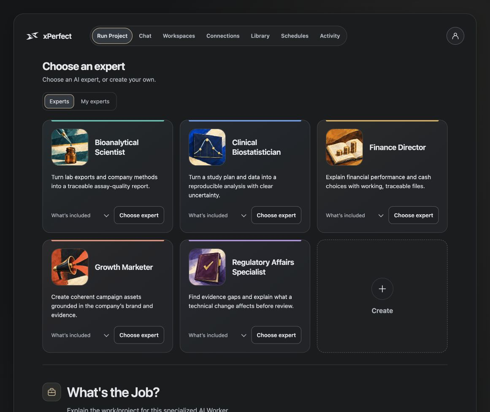
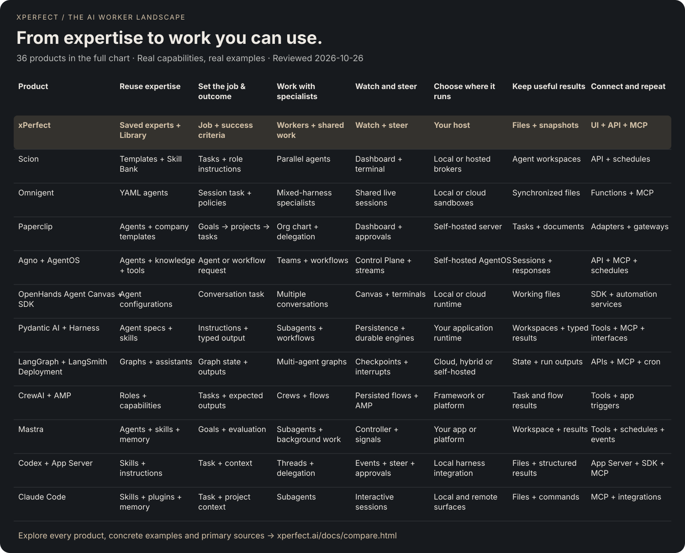
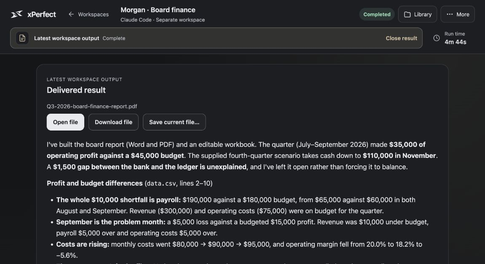

# xPerfect

<picture>
  <source media="(prefers-color-scheme: dark)" srcset="docs/assets/xperfect-logo-light.svg">
  
</picture>

**Build an AI team that knows your work.**

Choose a professional AI Worker, give it a job and the knowledge and tools it needs, and get
results you can open, inspect and use. xPerfect runs native AI tools such as Codex, Claude Code
and Grok, keeping each worker's files, progress and results together on your computer or server.

[**Start locally**](#start-locally) · [Visual guide](https://www.xperfect.ai/docs/) ·
[Try a complete example](docs/workshop.md) · [API and MCP](docs/developer.md) ·
[Compare the layers](docs/capability-matrix.md#what-xperfect-adds) · [Webhooks](runtime_phase1/README.md#generic-worker-and-webhook-schedules)

Our vision: turn experts' knowledge and skills into reusable AI counterparts that can work
across your channels and tools. The starting team below is one way to begin; you can create,
save and adapt your own workers.

## From a job to a result

1. **Choose who does the job.** Start with an expert, create your own, or reuse an existing worker.
2. **Get them onboarded.** Explain the required outcome. Add background, files and useful
   knowledge or tools from your Library.
3. **Run the work.** Follow progress, give more direction, and open or download the results.
   Return to the same saved work later.

An expert is a reusable worker setup, with its instructions and selected knowledge and abilities.
Starting from one creates a new worker. Reusing an existing worker continues its own work.



*Current expert picker, captured 25 October 2026: five starting professions and the Create card.*

## What xPerfect adds

Keep the native AI tools you trust. Give their workers one place for knowledge, controls,
schedules and results. Use xPerfect itself, connect another AI app, or build your own interface.

[](docs/capability-matrix.md#what-xperfect-adds)

[Read the full, accessible comparison and current limits](docs/capability-matrix.md#what-xperfect-adds).

## Meet your starting team

| Professional | Give them a job | Inspect the result |
| --- | --- | --- |
| [Clinical Biostatistician](runtime_phase1/src/workers_projects_runtime/starter_packs/clinical-biostatistician/README.md) | Assess a study's response difference and uncertainty. | Counts, effect estimates, assumptions and editable calculations. |
| [Bioanalytical Scientist](runtime_phase1/src/workers_projects_runtime/starter_packs/bioanalytical-scientist/README.md) | Reconcile assay exports and flag QC exceptions. | A traceable review and an editable results table. |
| [Regulatory Affairs Specialist](runtime_phase1/src/workers_projects_runtime/starter_packs/regulatory-affairs-specialist/README.md) | Check claims against a technical package. | An evidence map with missing and conflicting support. |
| [Growth Marketer](runtime_phase1/src/workers_projects_runtime/starter_packs/growth-marketer/README.md) | Prepare a launch from a brand brief and channel evidence. | Campaign and copy drafts with a measurement plan. |
| [Finance Director](runtime_phase1/src/workers_projects_runtime/starter_packs/finance-director/README.md) | Explain financial performance and cash changes. | A board brief and editable budget/cash calculations. |

Each package includes synthetic inputs, a meaningful job and checks you can repeat.
[Walk through the Finance Director example](docs/workshop.md), including a follow-up and bad input.
These are starting points, not professional credentials or certification. Their current native
skill path uses **Claude Code on the host**, with review for the actual worker. Optional tools
keep their own setup and account requirements; choosing an expert does not authorize them.



*Actual native work using the public synthetic Finance example. Open the report and editable
calculations, then [check them against their sources](docs/workshop.md#inspect-the-result).*

## Keep what works

Save files, onboarding notes, skills and bundles in your **Library**. Reuse exact versions with
the worker that needs them. Company material stays in your private selection; it does not become
part of the public starter package.

**Watch** brings progress, controls and delivered files together. Steer the selected worker,
pause or stop supported work, and return to its recorded status. In **Workspaces**, reopen a
worker or make a separate copy. **Schedules** can run a saved workspace later or send a webhook
to your app; the receiving app decides what happens next.

### Run later, or wake your app

**Schedules → New schedule** offers two paths:

- **Run a task:** have your saved AI Worker prepare a weekly financial review, check assay
  exports or draft a campaign update.
- **Send to an app:** post a team reminder, start an existing n8n or Make workflow, refresh an
  internal dashboard, or wake your own assistant. A webhook is a scheduled HTTP request;
  your connected app receives it and does its work. No AI account is needed just to send it.

[Set up your first webhook, see common recipes and check delivery](runtime_phase1/README.md#generic-worker-and-webhook-schedules).
Third-party recipes require that app’s receiving URL, payload and permissions; they are not
preconnected integrations. **Received by the app** means delivery was acknowledged, not that
the app’s job is finished.

**Settings → Work pauses and spend** can hold new work for your account or a project,
then resume the same queued work. Running work keeps going. Watch distinguishes reported
usage from unknown usage. Spending policies use reported money and explicit reserves when cost is unknown.
These limits control new admissions, not a provider's final bill.

Builders can use the optional [evidence kit](integrations/evidence-kit/README.md) to keep
original inputs, check exact output bytes and retry delivery without running the AI again.
It uses the same public APIs and run records; client rules stay outside xPerfect.

### Manage your experts and saved work

- **Workspaces → More → Save as expert** keeps a worker’s setup for another job. In
  **Run Project → My experts → Manage**, use **Edit** to save a new version, **Copy** for a
  separate expert, or **Versions** to inspect an earlier setup. Existing workers keep their setup.
- **Archive** puts an expert aside. **Remove** hides it after confirmation. Find it under
  **Archived** or **Removed** and choose **Restore** when you need it again.
- **Workspaces → More → Remove** stops that worker’s current and scheduled work, then hides its
  card. Files, results and history stay saved, including one-off work. **Removed → Restore**
  brings the same card back **Closed**; it does not restart the work. Use **Duplicate** for a
  fresh worker. Removal is recoverable and does not free that saved storage.

Use the browser, your own code or another AI application:

| Your starting point | Follow this path |
| --- | --- |
| Browser | [Quickstart](docs/quickstart.md): connect → run → open a result → return to it |
| Another AI app | [MCP walkthrough](docs/developer.md#1-connect-a-client): connect once, then discover and control work |
| Your own code | [HTTP API](docs/developer.md#4-the-same-finance-job-through-http-local): use the same worker, run and result records |
| A team server | [Hosted setup](docs/deployment-hosted.md): identity, storage, account setup and current limits |

## Start locally

### Use the AI tools on your computer

Requires macOS or Linux, Python 3.11 or newer, [uv](https://docs.astral.sh/uv/getting-started/installation/),
and an installed AI tool: [Codex](https://developers.openai.com/codex/cli/),
[Claude Code](https://code.claude.com/docs/en/setup) or [Grok](https://github.com/xai-org/grok-build).
The bundled experts currently use Claude Code; the other existing worker choices remain available.

[Download the source](https://github.com/xPerfectAI/xPerfect/archive/refs/heads/main.zip),
open a terminal in its folder, then run:

```sh
./xperfect start
```

The first start asks for an unlock password; choose one or save the generated password. Open the
printed address, unlock the app, and connect an AI account in **Connections**. Wait for **Ready**,
then open **Run Project**. The
[quickstart](docs/quickstart.md) walks through the remaining steps.

```sh
./xperfect doctor
./xperfect stop
./xperfect restart
```

A running page is not yet a connected AI. `doctor` shows the installed tools; Connections shows
account readiness. This local app is for one person and works with that user's permissions.

### Use Docker

With Python 3.11 or newer and Docker running, from the source folder:

```sh
./xperfect start --docker
```

The launcher downloads its release images and keeps private state under `~/xperfect-local`.
Open the printed URL and use `ui_password` from the private credentials file it prints. Keep that
file private; it also holds MCP credentials. The release has exact `linux/arm64` and
`linux/amd64` image pairs; startup selects the Docker daemon's CPU. Windows host startup
remains under construction. See
[package details](docs/deployment.md#packaged-linux) for the packaged version and settings.

## Your tools, your setup

xPerfect is a standalone control plane around native AI tools. It manages worker identity,
workspaces, lifecycle, scheduling, results and access; the native AI tool performs the work.
Applications can use it through MCP or the API without adopting this front end.

Separate workspaces keep workers' files apart. On a configured Linux host, shared workspaces
also offer **Common project files** or **Private files per member**. Sign-ins and sessions stay
separate. Sharing files does not by itself share chat history, tools or permissions. See
[workspace modes](docs/02_Architecture_and_Components.md#workspace-file-placement).

Ten goals do not mean ten workers at once. Manual host jobs take turns under a shared safety
lock. Chat can run its independent worker jobs together within account, native tool, machine and
configured limits. Host workers share the same desktop; native approval rules still apply.
A Direct model for Chat needs a configured API route; a native subscription sign-in alone does
not provide one. **Work together** lets you approve discovery and messages between
exact workers in your account; deployments without the required secure connection explain that
limit. [Working on several goals](docs/capability-matrix.md#working-on-several-goals).

Self-hosting keeps xPerfect's saved work on the machine or server you run. Connected AI providers
and integrations can receive the content needed for their requests. Local storage does not mean
local-only inference. [Security](SECURITY.md) · [Capabilities](docs/capability-matrix.md).

## Current limits

- **Hosted servers:** sign-in, per-person storage and upgrades have recorded checks. Full AI
  account connection and result delivery are not verified for every hosted route.
- **File drag and drop:** a full browser pass remains open. Use **Add files** and **Download**.
- **API-key accounts:** one native Codex path completed setup, work, a download and reload with
  an account-supported model. Other native API-key paths and GPT-6.1 API access remain unverified.
  See [account requirements](docs/host-setup.md).
- **Worker copies:** a copy can retain a Ready, compatible account selected by the same owner.
  Credentials, browser sign-ins and native chat history are not copied. An unavailable or
  incompatible account needs a new selection. [Copy behavior](docs/capability-matrix.md).
- **Shared workspaces:** require a configured Linux host; use a separate workspace on a Mac.
  This limit is separate from supported local Chat. Chat offers only the routes the actual
  deployment and installed tools can use. [Current support](docs/capability-matrix.md).

Grok needs an exact supported model: choose it under **Grok model** in Connections, or use
`./xperfect restart --model grok-build=<model>`. Missing authentication, unsupported setup and
exhausted capacity have different next steps. Follow the reported state rather than changing
accounts or calling incomplete work finished.

## Documentation

- [Visual user guide](https://www.xperfect.ai/docs/) · [Guide source](docs/user-guide/README.md)
- [Quickstart](docs/quickstart.md) · [Complete examples](docs/workshop.md)
- [Deployment and recovery](docs/deployment.md) · [Account setup](docs/host-setup.md)
- [Developer walkthrough](docs/developer.md) · [LiveKit reference](integrations/livekit/README.md)
- [Capability guide](docs/capability-matrix.md) · [Changelog](CHANGELOG.md)
- [Contributing](CONTRIBUTING.md) · [Security](SECURITY.md)

<details>
<summary>Technical contracts</summary>

0. [Key principles](docs/00_Key_Principles.md)
1. [Vision and terminology](docs/01_Vision_Requirements_and_Terminology.md)
2. [Architecture and components](docs/02_Architecture_and_Components.md)
3. [Bootstrap, auth and identity](docs/03_Bootstrap_Auth_and_Identity_Projection.md)
4. [MCP publication and clients](docs/04_MCP_Publication_and_Client_Compatibility.md)
5. [QA playbook](docs/05_QA_Quick_Power_Playbook.md)
6. [References](docs/06_References.md)
7. [Operator UI and design guidelines](docs/07_Minimal_Unified_Operator_UI.md)
8. [Repository and publication boundaries](docs/08_Repository_Structure_and_Publication_Boundaries.md)
9. [Application boundary and generic scheduled delivery](docs/09_Application_Boundary_Contract.md)

See the [runtime](runtime_phase1/README.md). Existing Python package names,
`WPR_`/`GLASSHIVE_` configuration and MCP/skill IDs remain compatibility interfaces.

</details>

## Creator

xPerfect is created by [Adrien Beyk](https://www.linkedin.com/in/adrienbeyk/).
[Instagram](https://www.instagram.com/adrienbeyk/)

## License

xPerfect is licensed under the [Apache License 2.0](LICENSE).
Third-party components retain their own licenses and notices. See [NOTICE](NOTICE).
