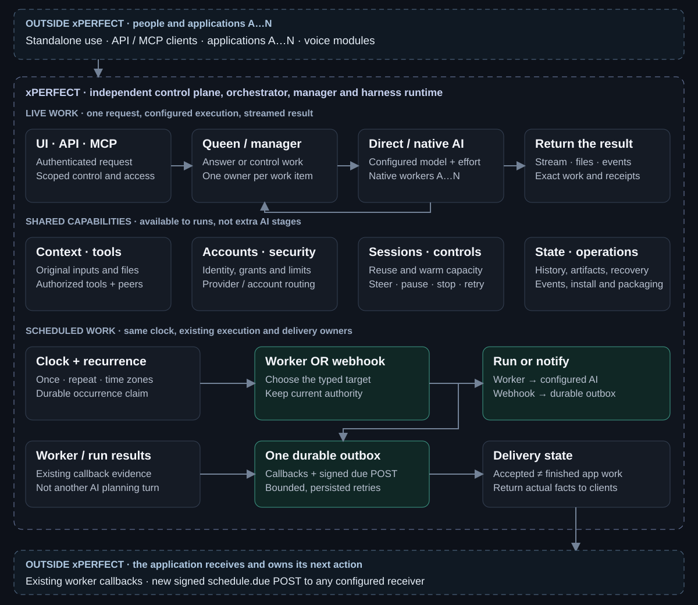

# Application boundary and generic scheduled delivery

**Status:** design approved on 2026-10-23; the generic target, transport and native-worker
interfaces are implemented. The implementation record below states the tested behavior and limits.
A source merge does not update an installed runtime or its pinned container images. Existing
compatibility and schedules remain supported. Client migration is separate.

## One product, many clients

xPerfect is the control plane, orchestrator, manager and harness of harnesses. It owns projects,
workers, goals, runs, model/harness configuration, original-context transport, authorized tools,
accounts, native sessions, lifecycle controls, scheduling, recovery, artifacts and runtime evidence.
Its operator UI, HTTP API and MCP expose the same underlying owners.

An application may supply its own identity, domain instructions, context, capabilities and output
policy. The application owns what those mean. xPerfect preserves and executes the authorized
request; it does not implement the application's domain state or decide how its users should be
contacted. A configured Queen may speak for the application while xPerfect remains the sole AI and
worker-control runtime. Do not add a second planner, orchestration owner or competing work ledger.

The [component architecture](02_Architecture_and_Components.md) owns existing runtime detail.
This document owns the application boundary, approved generic integration and its acceptance.
After implementation, API, MCP, UI and destination-auth details belong in their existing runtime
README and documentation owners (`03`, `04` and `07`); this contract links to those details.

### Dependency rule

- New core code, schemas, defaults, environment selection and tests must not require a named client,
  its database, prompt files, cognitive formats, channels, paths or credentials.
- Clients use typed public APIs/MCP, existing bootstrap/context projection, capability grants,
  streams, artifacts and callbacks. Shared data stays owner-scoped; transport does not rewrite it
  into a model-authored summary or drop native capabilities.
- Domain interpretation and client-specific translation live in the client or its integration
  package. Core accepts neutral typed identity, authorized context and opaque request references.
- Existing host-specific discovery, headers or semantic parsing are migration debt, not a template
  for new features. Move consumers coherently before retiring compatibility. A global string purge
  or deleting history is not a boundary fix.
- Extend a native mechanism only when it serves an independent client through the same contract.
  Do not introduce a client registry, cognitive SDK, second scheduler or second policy engine.

## Component owners and approved extension

The source has four layers: control plane, worker runtime, execution substrate and client adapters.
The following is a component map, not a claim that every capability is verified in a running build.

| Component | Implementation owner | Approved behavior |
| --- | --- | --- |
| UI, HTTP and MCP | `frontends/glass-drive-ui/`, runtime `api.py`, `mcp_server.py` | Same interfaces/service owners; expose generic schedule targets with API/MCP/UI parity. |
| Projects, goals, workers and runs | `service.py`, `store.py`, `coordinator.py` | Retain durable scope and exact-work management; no application work ledger added. |
| Queen, native conversations and Direct execution | `conversation_provider.py`, `native_model_selection.py`, `direct_runtime.py` | Same configured AI paths, original context and work controls; remove domain-format interpretation from the core. |
| Context, bootstrap, accounts and capabilities | `bootstrap.py`, `runtime_env.py`, authentication, credential and worker-context modules | Explicit neutral inputs and current grants; domain preparation and machine/app discovery stay outside core. |
| Native harnesses and substrates | Runtime adapters, host processes, Docker workspaces | Preserve selected models/effort, files, tools, human takeover and actual supported capabilities. No new scheduler target requires a provider. |
| Sessions, warm capacity and controls | Existing conversation/session, native admission and lifecycle owners | Reuse them. No parallel context cache, warm-worker pool or stop/steer framework. |
| Recurrence and due work | `recurrence.py`, schedule methods in `service.py` and `store.py` | Same clock/store; explicit owner and worker/webhook target. No client detection. |
| Outbox, retries and delivery | Existing callback methods and durable outbox | Add occurrence-scoped standard webhooks; retain worker callbacks; isolate transport capacity from long AI. |
| Events, files, evidence and security | Existing scoped store, event, artifact and authority owners | Keep exact identities and truthful states; record stage durations without private request material. |

An operator may declare local-only roots with `GLASSHIVE_PROTECTED_ARTIFACT_ROOTS`, a
platform path-separated list of absolute paths. Managed Files and artifact surfaces omit
protected entries and reject exports that contain them. This also applies to a previously
issued artifact link and to a retained native file selection. The policy controls managed
file delivery. Native filesystem access continues to follow the selected harness authority. If a
worker's workspace is local-only, a selected, verified result originating outside that root can
use the worker's runtime state for publication. Signed links retain their existing owner scope;
files in the protected root remain unavailable.

## Generic contract

### Schedule targets

Keep the existing recurrence definition and occurrence identities. Extend them with a discriminated
worker or webhook target. A worker target retains its worker, instruction, configured runtime and
provider admission. A webhook target uses a protected destination ID/version and an approved request
reference or owner-configured body; it needs no project/workspace, worker, model, provider account
or AI instruction. No fake project, worker, run completion or provider attempt may be created to
satisfy an old foreign key.

Reuse the existing `/v1/recurring-schedules` collection for a target-neutral create operation and
its existing get/update/retire/run-now/history operations. Preserve worker-specific entry points
as compatibility wrappers over the same service and storage. Final request field names follow the
owning runtime schema. Publish the actual runtime OpenAPI, not a separate incomplete draft.
Expose the same operations in the existing MCP/editor; keep specialized fast conversation profiles'
small work interface intact. Native workers receive only scoped schedule operations through the
existing live worker/run/attempt authority mechanism, never a service-wide token.

Creation retains an owner-scoped idempotency key and request digest. A lost reply recovers the same
definition; a changed request under the same key conflicts. Snapshot the version, target reference
and approved body into each occurrence. Secret references remain revocable; do not snapshot usable
bearer tokens or raw secret URLs into schedule, event or outbox history.

### When due

The same service clock atomically claims the current occurrence and retains one outbox intent.
For a webhook target it launches no AI. After commit, bounded transport sends an authenticated
Standard Webhooks POST to the configured receiver. The default signed JSON carries `schedule.due`,
scheduled timestamp, schedule ID/version, effective expiry, authenticated principal where needed,
and approved request data. Standard headers carry the stable event ID, fresh attempt timestamp
and signature. Existing endpoints may use explicit raw-body mode; then they receive no trusted
schedule metadata beyond the signed ID and attempt time. A raw-body consumer owns its semantics.

HTTP 2xx means accepted delivery, not finished application work. The receiver owns its work,
idempotency and outcomes; no result-settlement or receipt-query API back into xPerfect is required.
A receiver promising durable asynchronous acceptance commits its request before ACK and releases
ACK and background work independently. xPerfect keeps accepted, rejected, expired/unacknowledged,
queued and cancellation uncertainty distinct. A lost reply does not prove that work never started.

### Security and timing

Owner-authorized setup controls the URL, auth and payload boundary. Workers select only supplied
destinations and trusted request references or owner-configured bodies. Runtime authority supplies
tenant/owner; nested request data cannot grant roles, tools or context access. Protect the whole
URL, including path/query credentials. Use scoped private secret references, isolated signer keys,
revocation/rotation and safe failure classes, not raw HTTP exception strings. Only service authority
can use installation keys. Optional auth must not override generated identity/signature, Host or
length headers. A compromised key is revoked immediately; planned rotation may use a bounded
overlap. Bound and verify raw bytes before interpreting data, and retain scoped dedupe/digest
receipts for the permitted retry/recovery horizon.

Remote connections require certificate-verified HTTPS. Explicit operator-scoped local destinations
remain supported. Disable redirects; validate actual IPv4/IPv6 connection targets against network
policy, including DNS/proxy/fallback behavior. Do not perform one safe lookup then an unchecked
second connection. Hosted multi-tenant deployments deny loopback, private, link-local and metadata
targets unless explicitly operator-allowed; local loopback is allowed only in its operator-scoped
profile. Reject URL userinfo/fragments and non-allowed schemes/ports. Managed client pools keep no
shared cookie jar or shared auth defaults. Reuse existing safe transport or deployment egress controls.

Bound payload/response bytes, phase and total attempt time, schedules and attempts per owner,
per-destination/service capacity, fair due selection and retry volume. Preserve explicit retry
policies and finite expiry; do not accidentally inherit an early fixed-attempt stop. Snapshot and
fence queued versions; cancelling a clock does not retract a sent/accepted HTTP request. An already
accepted request is recovered by the receiver, not rerun by the sender.
Start no new attempt after expiry; bound an active attempt by its remaining time budget.

Add schedule due times to the existing capped earliest-wake calculation; signal its existing event
after committed create/edit/run-now. Retain other maintenance and bounded recovery/capacity waits.
Use one outbox retry owner, persisted next-attempt time, a small bounded transport executor and a
managed HTTP client with per-request auth. Do not sleep between retries while holding a transport
slot, submit an unbounded backlog, or hold a database transaction over network I/O. Pooling mainly
helps bursts/retries; low-frequency schedules may outlast idle connections.

A restart may reclaim a lease early only with proof that the prior sender is inactive and the
existing ownership/generation fence is valid. Otherwise retain lease recovery; do not invent a
safe immediate takeover. The model, harness and application still own their downstream execution
costs. No zero-latency or universal end-to-end response guarantee follows from the webhook design.

Inspected source defaults identify the work to challenge: the shared scheduler waits up to its
configured 5-second scan after cycle work; first callbacks submit immediately but share an
8-thread pool with missions; recovery scans serial pending delivery every 30 seconds and uses
three-attempt bursts with blocking waits. A 25-attempt limit and 300-second crash-held lease are
not a schedule's promised recovery window. These are source defaults, not current configured or
measured delays. Keep the existing store's durable transactions/WAL and connection reuse.
Record sender signing separately: the earlier local HTTP prototype measured receiver verification
and commit in its roughly 0.5–15 ms replies but excluded signing, TLS and the product clock.

## Technical execution sequence

| Step | Change and owning seams | Exit condition |
| --- | --- | --- |
| X1 — Capture compatibility | Inventory existing schema/config/broker/header/context consumers in the architecture, bootstrap/auth and publication owners. Classify host-specific behavior by semantic owner; retain source/version and supported inputs. | Every affected consumer has an owner and a compatibility transition; working native paths remain intact. |
| X2 — Neutralize the boundary | Use explicit context/prompt inputs and typed principal/capability metadata. Move domain parsing, ancestor/sibling app discovery and app-name clock selection into client setup/adapters. Reuse current native conversation/coordinator, sessions and original-context courier. | All affected generic paths work without a named app's folders, formats, identity headers or environment markers. Preserve the existing independent standalone path and complete authorized context for current clients. |
| X3 — Extend the existing schedule | Update `models.py`, `store.py` and service methods for target union, retry-safe creation, immutable occurrence request and explicit single clock owner. Migrate dependent worker/run foreign keys coherently; retain old records and worker-target behavior. | A plain webhook can be saved without a dummy worker/provider. Current schedules and lifecycle controls retain their identities and effective policy. |
| X4 — Expose and deliver | Extend API/MCP/editor over that same service. Project narrowly scoped scheduling to native workers. Extend the existing outbox with occurrence-scoped signing, protected destinations, current authority and safe retry eligibility. | HTTP/MCP/UI and a real worker create/control the same definition; a separate non-AI app receives an actual due POST. |
| X5 — Remove waiting safely | Extend existing wake calculation/events; use bounded independent transport capacity and client reuse; persist backoff. Apply the security/network/resource contract above. | Due work does not depend on a scan sleep or an available AI mission thread; retries do not block healthy destinations or extend authority. |
| X6 — Accept standalone first | Run the applicable cases below with synthetic accounts/apps; retain existing native worker acceptance, generated schemas/artifacts and startup checks. | xPerfect's own acceptance passes without an application server or cognitive modules installed. |
| X7 — Integrate clients | Each client uses its own adapter and tests its domain behavior. Retire old coupling only after its confirmed consumers pass equivalent behavior, recovery and install/upgrade checks. | The same public contract supports two independent receivers; no client-specific code is required in the new core path. |

**Independent release boundary:** X1–X6 are xPerfect's own compatible implementation and release
batch. They add and accept neutral paths while retaining existing compatibility; X2 does not require
every client to migrate first. X7 runs separately for each client after that client's acceptance and
then permits retirement of its old coupling. xPerfect's generic release does not depend on one
application's rollout. Do not mistake retained compatibility for permission to add new client semantics.

Use focused causal checks while developing, then run affected acceptance once on the completed
candidate; do not rebuild unchanged native features or repeat broad provider suites after each edit.

## Standalone success criteria

| ID | Required proof before implementation is called complete |
| --- | --- |
| XP-1 Independence | Start/install xPerfect from its documented entry with no application source, database, private prompt tree or app-specific environment. Use UI, HTTP and MCP normally. No optional client integration blocks startup. |
| XP-2 Native parity | Preserve configured harness/model/effort/accounts, original conversation/files/tools, Queen/worker A…N handoff, exact-worker steering, result callbacks and artifact access. Reuse valid native proofs; rerun only changed consumers. |
| XP-3 Target parity | Owner API/UI/MCP create, edit, pause/resume, run-now, retire and reload the same worker or webhook definition. A native worker invokes only its authorized scheduling operations; a plain webhook requires no AI account. |
| XP-4 Real receiver | Actual due clock → signed POST → a small non-AI receiver, plus an existing raw-body receiver where configured. Six normal form actions, optional payload/auth only when needed; no registration page or custom SDK. |
| XP-5 Durable recovery | Concurrent create retries yield one definition; duplicate/lost replies/restart yield one scoped admission; changed-body same-key conflicts. Exercise version/cancel/expiry races, offline receiver and safe lease recovery. Do not claim arbitrary external exactly-once effects. |
| XP-6 Security | Cross-owner/tenant attempts, secret URLs/headers/error canaries, rotation/revocation, replay/tamper, DNS/redirect/proxy/IPv4/IPv6 policy and request/response bounds pass on the delivered target. Public examples contain no private data. |
| XP-7 Efficient scheduling | Deterministic checks prove earlier due/create/edit/run-now wake while preserving the existing maintenance cap; fair bounded batches progress. With all AI mission slots busy and one slow receiver, a healthy webhook proceeds without waiting for an AI mission to finish. No retry sleep holds transport capacity. |
| XP-8 Timing evidence | Record due→claim→outbox commit→executor entry→sign/connect/send→receiver commit/ACK separately, with p50/p95 and bounded-load/idle evidence. Keep source defaults, configured policy, measured durations and network/AI time distinct; handle cross-host clock skew. |
| XP-9 Compatibility/release | Existing schedules, worker callbacks, native sessions, context and controls pass their changed consumers. Add one focused dependency/interface check for the new schedule/webhook/context seam: it imports no client package, reads no client-specific environment/path, and requires no app-named request field. Scope it to the new neutral path, not a repository-wide word ban or deletion of legacy compatibility. Component source, tests, schema, built/installed candidate and visible behavior agree. No runtime availability or latency claim rests on a prototype. |

The earlier local HTTP demonstration supports signature, duplicate admission and restart mechanics
only. It does not replace acceptance of this product target. Use the implementation record below
and the linked tests for current evidence; do not infer product readiness from the design.

## Approved architecture

This diagram describes ownership. Shared capabilities are available to a run, not mandatory serial
AI calls. A webhook needs no model, project, worker or application framework.

## Local implementation record — 2026-10-23

- `schedule_targets.py` extends the existing recurrence tables, clock and callback outbox. Worker
  associations are nullable only for webhook targets. Schema migration is transactional and keeps
  prior rows, indexes, triggers and foreign-key integrity.
- `schedule_webhooks.py` uses Standard Webhooks with a stable event ID and fresh attempt timestamp.
  Destination URLs, optional auth and signer keys are protected owner configuration, never model
  tool arguments or public history. Delivery uses checked, pinned connections, verified remote TLS,
  no redirects, finite byte/time limits and explicit operator network policy.
- The current service wake event includes earlier scheduled work and persisted retry times.
  Independent bounded transport does not wait for an AI execution slot. Both due-definition and
  outbox admission give each owner progress.
- The owner API, MCP and existing Schedules editor share one service. Native workers receive
  attempt-scoped scheduling access through the existing peer authority. A create/retarget operation
  needs an exact supplied destination/reference; a separately granted destination-management scope
  allows later authorized workers to list, edit or cancel earlier schedules for that same owner.
- Each due envelope freezes schedule/version, occurrence, scheduled time, finite expiry, principal,
  specific saved instruction and approved request data. Original conversation context is not
  rewritten into a handoff brief. Plain non-AI targets may leave the instruction empty.
- History retains HTTP status and stage durations. Accepted means a receiver returned 2xx, not that
  its application finished. Cancellation stops future attempts but cannot recall a sent request.
  A lost reply remains unacknowledged; a known ACK remains accepted even if cancellation races it.
- Neutral launch authority, opaque-context and environment inputs coexist with validated legacy
  aliases. Existing client semantic projection remains compatibility until its producer and all
  consumers can migrate with equivalent evidence. This change does not claim a global legacy purge.

Owning checks: `test_schedule_webhooks.py`, `test_schedule_target_service.py`,
`test_schedule_target_interfaces.py`, `test_schedule_native_access.py`,
`test_application_boundary.py`, and the operator frontend target tests. These cover the changed
contract; unrelated provider evaluations are not part of this scheduling batch. Actual installed
startup, native-worker and browser acceptance must be recorded before a ready-to-use claim.
Local browser acceptance exercised create/edit/reload/pause/resume/history and both app receipt
and failure states. An isolated slow app updated from Sending to Received without another action
or page refresh; two attempts produced one receiver effect. The actual UI-server definition-read
route, not only a mocked runtime endpoint, is part of that check. First rejection and committed
work with a lost reply remain distinct. These checks prove delivery receipts, not task completion
inside an app. Ordinary setup requires only what, where and when; technical options stay optional.

### Timing and recovery findings

The local product-clock experiment used an independent durable non-AI receiver, not a mocked
transport. Twelve idle deliveries were acknowledged: due-to-ACK p50 **36.50 ms**, p95 **57.02 ms**.
With all eight AI execution slots occupied and one receiver delayed by 300 ms, all twelve completed;
the eleven healthy deliveries measured p50 **98.40 ms**, p95 **170.64 ms**. These same-host, small-sample
observations demonstrate transport independence, not an internet or application-response guarantee.
AI generation and client delivery remain separate costs.

- The wake event drains a progressing full batch. Past-due invalid work must not create a 10 ms
  polling loop; the normal maintenance/recovery cap remains available.
- A lost acknowledgement stays uncertain across retries, sender-lease recovery, later rejection,
  cancellation and expiry. A later positive acknowledgement can settle it. Cancellation cannot
  erase a completed occurrence or prove that a sent request had no effect.
- Protected connection identity stays stable across key rotation. An address change creates a new
  protected connection, and owner-scoped version checks retarget future work without rewriting
  receipts or in-flight requests. Bounded payloads are checked before saving and sending.
- App scheduling setup is lazy at the existing native handoff boundary. Ordinary fast-Queen replies
  do not prepare scheduling grants or wait for a clock lookup.

## Selected files from earlier accepted work

A trusted client may declare `authorized_result_files` in its signature-verified bootstrap bundle.
Each entry contains only `run_id`, `attempt_id` and `sha256`. The client owns its domain selection
and current accepted-result checks. A content hash grants no access by itself. Native verifies the
source run's exact attempt, terminal state, owner, tenant, project and captured bytes, then reuses
the existing immutable file publisher under the source run's authority. Protected roots remain
protected. An undeclared, unreadable or unpublishable file becomes a typed rejection and a visible
file-unavailable marker while useful reply text is retained; it never becomes an unverified link.
Owner, tenant and run identity failures still fail closed. The committed reply replays unchanged,
including when a publication I/O failure caused the rejection. This does not certify a requested
file as delivered or discard its saved source bytes. Required mission outputs keep their own
completion checks.

The declaration belongs to the saved per-request completion contract. It is removed from the
stable worker bundle. A retry uses its admitted contract. Clients import through their existing
authenticated file route and recheck the accepted source before committing a delivered attachment.
A file transport failure is distinct from a model failure.

The registered file-delivery contract receives current artifact-root facts for host-native conversations and missions:
workspace and managed temporary directory are each `supported`, `local_only` or `unknown`. Facts
contain no paths and grant no additional read or publication authority. A local-only root and its
existing contents stay local, including copies. Models can choose a supported root for a new
requested deliverable. When the default workspace is local-only, a new requested deliverable
originates in a supported temporary root before any optional inward private archive copy. Existing
local-only content cannot be exported by copying or regenerating it elsewhere. Runtime path and
byte checks remain authoritative.

### Current visual input

Native image blocks belong to the current accepted source messages, using the same verified
source identities as text admission. Without explicit source selection, the final conversation
turn owns the fresh image input. Do not reattach the whole transcript's images as one new user
batch. Historical originals remain materialized and available through existing authorized file
readers and retained native history. Multiple current sources preserve their image order; a
text-only turn does not resend an older photo as current input.

Historical file materialization is not an inference batch. It preserves validated, content-addressed
originals through the existing file owner without applying the fresh image batch's aggregate item
or byte bounds to the conversation's lifetime archive. This also applies to cold and stateless
inline-only callers without an application upload ledger. Current input keeps its own batch and
per-file validation. A growing photo history must not prevent a later text turn from reaching its AI.

### Application-prepared native coordination

An application can retain its speaking assistant while the existing native coordinator manages
background goals. `CoordinatorConfig.application` supplies a protected Standard Webhooks
`destination_id`, an opaque `request_ref`, and an explicit delivery expiry. The configuration is
accepted only through the existing trusted bootstrap signature. The owner-scoped reference is
idempotent: the same configuration returns the same conversation; changed content conflicts.
Application configurations cannot retain a reusable bootstrap bearer or developer context.

`POST /v1/coordinator/conversations/{id}/turns` first saves the original request. Existing native
maintenance emits `coordinator.turn_due` through the same callback outbox and bounded webhook
transport used by schedule delivery. The event contains owner identity and opaque references,
not prompts or credentials. The application prepares its current authority and context, then
submits an ordinary signed native completion to `/turns/{turn}/prepare`. Native coordination
checks the exact owner, conversation, turn, model, effort, origin scope and system/worker lane,
adds its registered role and original accepted input, and starts through the existing provider.
An exact admitted request is recovered before another inference can start. The provider owns
completion persistence; the coordinator retains a minimal projection without fresh bearer tokens.
`GET /turns/{turn}` exposes compact native state and its authoritative action mask.

Explicit Retry of a settled failed planning turn reuses the existing turn owner. It retains the
failed attempt and creates one deterministic child with the exact accepted message and Library
selection. The child resolves back to the original source for fresh application preparation and
goal/result attribution. Duplicate clicks and lost replies recover that same child; a failed child
can be retried explicitly without a lifetime retry ceiling. Parsed replies, accepted source goals,
Stop, restore hold and foreign ownership fence new retries. Retry is a new explicit execution
intent, not a claim that the failed attempt had no effects. Status links the accepted retry before
the application retires its parent's failed card. Existing standalone provider preparation remains
with its own turn owner.

In this mode, an accepted goal selects an exact original interactive message or contiguous clause.
`source_turn_id` can select an earlier retained interactive source. Dispatch defaults to that saved
original goal. Separate optional specialist `guidance` does not replace the goal. Dispatch intent,
digest and admission order are saved before `coordinator.dispatch_due` is emitted. The application
uses `/goals/{goal}/prepare` to provide an ordinary delegation under its own opaque idempotency and
origin identities. Native validation reserves without starting, attaches the goal, and then wakes
the same worker admission owner. Stop and continuity hold fence reservation, attachment and start.
Existing standalone routes retain their contract and receipt bytes.

Rich user controls use `/goals/{goal}/actions?run_id={exact-control-run}` with the ordinary work-action
body. Its receipt endpoint adds `/receipt`. Both retain native input, inherited context, file
selection and refreshed authority through the existing action receipt owner. The coordinator
binds any resulting run before it starts. A stable goal alias can recover the original exact
receipt after its current run advances. Pending and self-handled goals support their existing exact
Stop without creating a fake worker or delegation. The native action list is authoritative.

Owned coordinator goal snapshots may retain the existing read-only Worker View link even after a
completed delegation leaves the recent Active Work window. The API resolves the bound delegation
under the current tenant and owner, then uses the same signed-link owner as ordinary work detail.
It grants no mutation or filesystem authority. Missing, inaccessible or unsigned views remain
unavailable; clients must not invent a link from an internal worker or path.

An unlaunched application goal whose dispatch delivery was rejected or expired can expose exact
Retry. This is a blocked launch, not a request for user input. Within the original transport
horizon, Retry reuses its immutable outbox event. After expiry, a new authenticated Control intent
creates one new event in the same outbox; its identity follows that exact control key. The old
payload, expiry and history remain unchanged. The current notification reference is retained in
the existing preparation receipt and fences delivery, preparation, reservation and late replies.
Maintenance follows that saved reference; it cannot renew expiry. Current references are exposed
by the dispatch reader and carried unchanged to the existing prepare endpoint.
Only that explicit owner action permits one fresh preparation before any reservation exists.
Original source, route and opaque application identity remain fixed. Prior preparation digests
and generations remain retained, and current signed capabilities are validated again. A transport
retry never renews the independently owned mission authorization horizon. Once work is reserved,
its ordinary immutable request owner governs recovery. Stop, restore hold, withdrawn delivery,
unavailable destinations and unrelated ownership remain fenced. Repeating a control key cannot
repeat its retry or create another worker.

Worker results keep the existing application delivery owner. The background coordinator's plain
reply is internal; it is not another speaker or another approval gate for every result. A goal
handled by the coordinator itself emits `coordinator.result_ready` only after its canonical native
completion is saved. The paged goal result retains its exact publisher identity and canonical
output-file envelope. All event kinds share existing outbox retry, destination revocation,
source fencing, expiry and uncertainty handling. No second queue, clock, scheduler, memory store
or worker manager is introduced.

An application-backed accepted interactive turn can also finish directly, without a goal-owned
result. Its saved canonical assistant response emits the distinct `coordinator.turn_result_ready`
through the same observer and outbox. Re-observation backfills completed turns once; it does not
rerun the model. The selected-turn result reader binds the actual turn, request, run, revision and
publisher, and pages the saved canonical assistant text. Its digest covers that exact text, while
declared file metadata comes from the same canonical response. Goal-owned replies, internal result
wakes and failed turns retain their existing paths. Current Stop, hold and source ownership fence
presentation; the application keeps its existing speaking assistant and delivery owner.
An accepted goal alone records intent. It suppresses this direct turn result only when its same
source has a durable dispatch or actual work, worker or run binding; a goal bound to this exact
Native run also owns that result. An unstarted intent does not hide a completed canonical answer
and is not marked complete by its delivery.
Compact owner-authorized interactive turn status retains the exact accepted message and creation
timestamp so work labels use the existing source instead of a generic placeholder. Internal result
wake bodies and full response history remain outside that compact projection.

The read-only `/v1/coordinator/conversations/{id}/publications` reader projects retained
`coordinator.result_ready` and `coordinator.turn_result_ready` identities from that same callback outbox. Authenticated tenant, owner
and conversation scope apply to every page and cursor. It returns only event identity, original
timestamps and typed result references, without destinations, credentials or result bodies.
Clients can drain all pages. Expired or superseded entries remain provenance; they do not renew
delivery deadlines or authorize an old result to be presented. Current goal intent, run and restore
hold retain their existing authority.

Application-managed Queue, Message, Steer and Retry retain the same native action intent, then emit
`coordinator.action_due`. The application prepares fresh cognition and a signed invocation bundle
through the same `/goals/{goal}/actions` owner. Its app-only `application_bootstrap_bundle_b64`
carrier is separate from the immutable ordinary action request; usable authority stays in the
existing invocation-local bundle owner. A credential-free run marker prevents restart from
falling back to old worker context. Native maintenance can request fresh context for the same
queued effect after a restart. A complete current opaque invocation replaces prior application
context, rather than merging old cognition, broker data or credentials. Native execution policy,
mission authorization, source identity and callback bindings retain their existing owners. The
mission admission owner provides its new invocation grant separately. Missing refreshed context
fails before admission; a restart cannot execute using a stored bearer. Preflight and exact receipt reads recover completed operations
before another capability grant is prepared; they never repeat the action. Recovery selects pending
receipts and unsettled queued effects, rather than stopping at a fixed number of historical actions.

Fresh action bundles use the same selected-upload projector as new delegations. Projection follows
signature and authenticated tenant/owner checks, preserves stable file identity and the supplied
original or extracted representation, and reuses existing upload-root checks and materialization.
Explicitly foreign descriptors are rejected before an action is reserved. Receipt reads do not
project files or repeat an effect.

The selected-file ledger carries every authorized original reference, including long conversation
history. It has no separate aggregate file-count ceiling. Each entry still requires its ordered
schema, stable reference and authenticated owner/tenant; missing or ambiguous references fail before
reservation. Repeated identical records do not create duplicate files. Existing transport and host
resource owners govern capacity; the ledger does not impose an inference batch budget on stored files.

Projected uploads and managed native inputs share the existing per-run input index. Its registered
worker instruction supplies the index path on both initial launch and an existing worker's next run.
Each projected entry retains its source file identity, actual workspace path and original or extracted
representation. Extracted text records its exact byte count and hash; unavailable originals remain
explicit blockers. Generic workspace files are not inferred to be selected inputs.

Application mode exposes configured routes and exact continuation controls for its existing goal
workers. It does not authorize attachment to pre-existing project experts: its worker roster is
empty and `worker_reuse_supported` is false. Standalone project-expert reuse remains supported.
This preserves the existing project and application grant boundaries without claiming unsupported
capability parity. A null `max_goals` removes the historical goal-count budget; explicitly
configured legacy budgets still apply. Originals and results remain retained. Compact acceptance
and `include_history=false` status projection avoid copying old message bodies on the reply path.
Generated result turns group events by their retained goal's original source, so later unrelated
inputs cannot change a worker result's context.

Goal status exposes the retained `intent_state` and an effective boolean `restore_hold` covering
both the goal and conversation. Result pages expose `result_revision` from the exact selected
run's terminal revision, alongside the existing full-output hash and canonical publisher identity.
These fields let application delivery verify cancellation, restoration and result generation
without replacing native process state or guessing a revision.

## Integration compatibility for original-context coordination

The coordinator base role remains version 3. Application coordination adds its separately
versioned layer 1; tool schema version 4 permits an omitted dispatch instruction and keeps optional
specialist guidance separate from the accepted original goal. Existing saved conversation prompt
snapshots retain their exact content and source hashes.

A completed run can emit its canonical `cb_terminal_` callback while its broader work still has a
queued follow-up. Its `result_state`, `result_revision`, `result_digest` and `result_ended_at` describe
that exact run; `work_terminal: false` means the work continues. Consumers must treat callback IDs
as opaque, retain the typed run-result fields and use work state separately. A nonempty partial
result from a failed run is evidence of that failure, not proof of successful completion.
