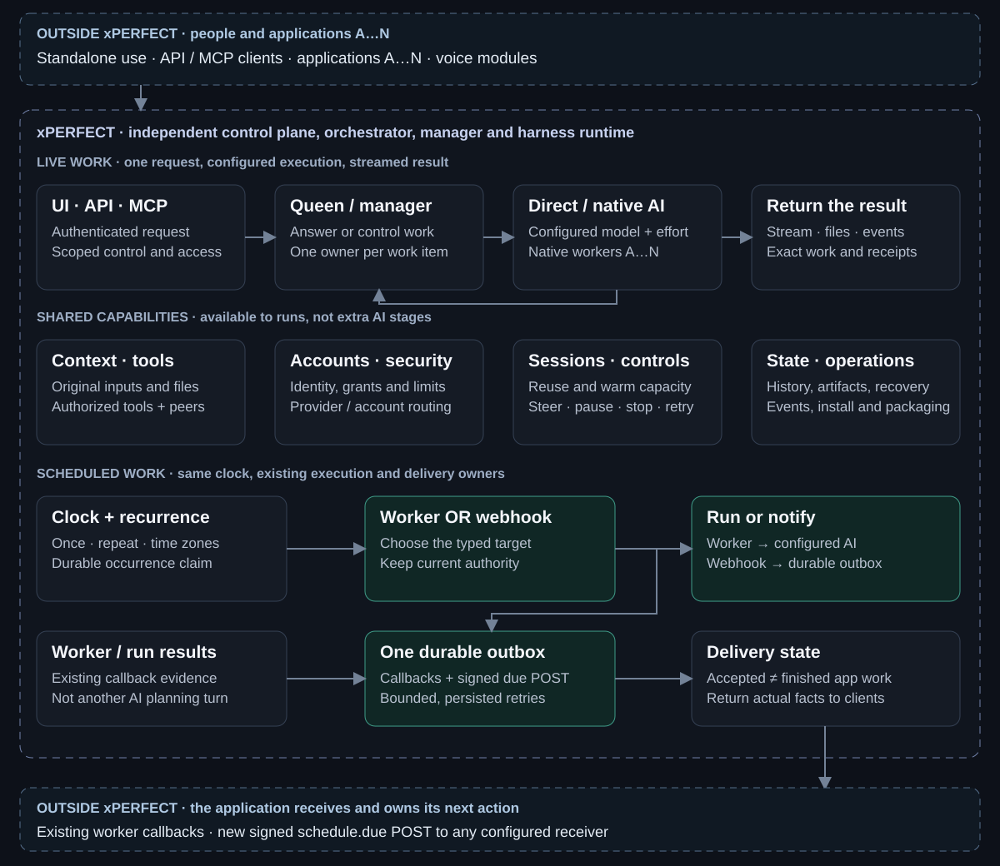

# Application boundary and generic scheduled delivery

**Status:** design approved on 2026-10-23; the generic target, transport and native-worker
interfaces are implemented. The implementation record below states the tested behavior and limits.
A source merge does not update an installed runtime or its pinned container images. Existing
compatibility and schedules remain supported. Client migration is separate.

## One product, many clients

xPerfect is the control plane, orchestrator, manager and harness of harnesses. It owns projects,
workers, goals, runs, model/harness configuration, original-context transport, authorized tools,
accounts, native sessions, lifecycle controls, scheduling, recovery, artifacts and runtime evidence.
Its operator UI, HTTP API and MCP expose the same underlying owners.

An application may supply its own identity, domain instructions, context, capabilities and output
policy. The application owns what those mean. xPerfect preserves and executes the authorized
request; it does not implement the application's domain state or decide how its users should be
contacted. A configured Queen may speak for the application while xPerfect remains the sole AI and
worker-control runtime. Do not add a second planner, orchestration owner or competing work ledger.

The [component architecture](02_Architecture_and_Components.md) owns existing runtime detail.
This document owns the application boundary, approved generic integration and its acceptance.
After implementation, API, MCP, UI and destination-auth details belong in their existing runtime
README and documentation owners (`03`, `04` and `07`); this contract links to those details.

### Dependency rule

- New core code, schemas, defaults, environment selection and tests must not require a named client,
  its database, prompt files, cognitive formats, channels, paths or credentials.
- Clients use typed public APIs/MCP, existing bootstrap/context projection, capability grants,
  streams, artifacts and callbacks. Shared data stays owner-scoped; transport does not rewrite it
  into a model-authored summary or drop native capabilities.
- Domain interpretation and client-specific translation live in the client or its integration
  package. Core accepts neutral typed identity, authorized context and opaque request references.
- Existing host-specific discovery, headers or semantic parsing are migration debt, not a template
  for new features. Move consumers coherently before retiring compatibility. A global string purge
  or deleting history is not a boundary fix.
- Extend a native mechanism only when it serves an independent client through the same contract.
  Do not introduce a client registry, cognitive SDK, second scheduler or second policy engine.

## Component owners and approved extension

The source has four layers: control plane, worker runtime, execution substrate and client adapters.
The following is a component map, not a claim that every capability is verified in a running build.

| Component | Implementation owner | Approved behavior |
| --- | --- | --- |
| UI, HTTP and MCP | `frontends/glass-drive-ui/`, runtime `api.py`, `mcp_server.py` | Same interfaces/service owners; expose generic schedule targets with API/MCP/UI parity. |
| Projects, goals, workers and runs | `service.py`, `store.py`, `coordinator.py` | Retain durable scope and exact-work management; no application work ledger added. |
| Queen, native conversations and Direct execution | `conversation_provider.py`, `native_model_selection.py`, `direct_runtime.py` | Same configured AI paths, original context and work controls; remove domain-format interpretation from the core. |
| Context, bootstrap, accounts and capabilities | `bootstrap.py`, `runtime_env.py`, authentication, credential and worker-context modules | Explicit neutral inputs and current grants; domain preparation and machine/app discovery stay outside core. |
| Native harnesses and substrates | Runtime adapters, host processes, Docker workspaces | Preserve selected models/effort, files, tools, human takeover and actual supported capabilities. No new scheduler target requires a provider. |
| Sessions, warm capacity and controls | Existing conversation/session, native admission and lifecycle owners | Reuse them. No parallel context cache, warm-worker pool or stop/steer framework. |
| Recurrence and due work | `recurrence.py`, schedule methods in `service.py` and `store.py` | Same clock/store; explicit owner and worker/webhook target. No client detection. |
| Outbox, retries and delivery | Existing callback methods and durable outbox | Add occurrence-scoped standard webhooks; retain worker callbacks; isolate transport capacity from long AI. |
| Events, files, evidence and security | Existing scoped store, event, artifact and authority owners | Keep exact identities and truthful states; record stage durations without private request material. |

## Generic contract

### Schedule targets

Keep the existing recurrence definition and occurrence identities. Extend them with a discriminated
worker or webhook target. A worker target retains its worker, instruction, configured runtime and
provider admission. A webhook target uses a protected destination ID/version and an approved request
reference or owner-configured body; it needs no project/workspace, worker, model, provider account
or AI instruction. No fake project, worker, run completion or provider attempt may be created to
satisfy an old foreign key.

Reuse the existing `/v1/recurring-schedules` collection for a target-neutral create operation and
its existing get/update/retire/run-now/history operations. Preserve worker-specific entry points
as compatibility wrappers over the same service and storage. Final request field names follow the
owning runtime schema. Publish the actual runtime OpenAPI, not a separate incomplete draft.
Expose the same operations in the existing MCP/editor; keep specialized fast conversation profiles'
small work interface intact. Native workers receive only scoped schedule operations through the
existing live worker/run/attempt authority mechanism, never a service-wide token.

Creation retains an owner-scoped idempotency key and request digest. A lost reply recovers the same
definition; a changed request under the same key conflicts. Snapshot the version, target reference
and approved body into each occurrence. Secret references remain revocable; do not snapshot usable
bearer tokens or raw secret URLs into schedule, event or outbox history.

### When due

The same service clock atomically claims the current occurrence and retains one outbox intent.
For a webhook target it launches no AI. After commit, bounded transport sends an authenticated
Standard Webhooks POST to the configured receiver. The default signed JSON carries `schedule.due`,
scheduled timestamp, schedule ID/version, effective expiry, authenticated principal where needed,
and approved request data. Standard headers carry the stable event ID, fresh attempt timestamp
and signature. Existing endpoints may use explicit raw-body mode; then they receive no trusted
schedule metadata beyond the signed ID and attempt time. A raw-body consumer owns its semantics.

HTTP 2xx means accepted delivery, not finished application work. The receiver owns its work,
idempotency and outcomes; no result-settlement or receipt-query API back into xPerfect is required.
A receiver promising durable asynchronous acceptance commits its request before ACK and releases
ACK and background work independently. xPerfect keeps accepted, rejected, expired/unacknowledged,
queued and cancellation uncertainty distinct. A lost reply does not prove that work never started.

### Security and timing

Owner-authorized setup controls the URL, auth and payload boundary. Workers select only supplied
destinations and trusted request references or owner-configured bodies. Runtime authority supplies
tenant/owner; nested request data cannot grant roles, tools or context access. Protect the whole
URL, including path/query credentials. Use scoped private secret references, isolated signer keys,
revocation/rotation and safe failure classes, not raw HTTP exception strings. Only service authority
can use installation keys. Optional auth must not override generated identity/signature, Host or
length headers. A compromised key is revoked immediately; planned rotation may use a bounded
overlap. Bound and verify raw bytes before interpreting data, and retain scoped dedupe/digest
receipts for the permitted retry/recovery horizon.

Remote connections require certificate-verified HTTPS. Explicit operator-scoped local destinations
remain supported. Disable redirects; validate actual IPv4/IPv6 connection targets against network
policy, including DNS/proxy/fallback behavior. Do not perform one safe lookup then an unchecked
second connection. Hosted multi-tenant deployments deny loopback, private, link-local and metadata
targets unless explicitly operator-allowed; local loopback is allowed only in its operator-scoped
profile. Reject URL userinfo/fragments and non-allowed schemes/ports. Managed client pools keep no
shared cookie jar or shared auth defaults. Reuse existing safe transport or deployment egress controls.

Bound payload/response bytes, phase and total attempt time, schedules and attempts per owner,
per-destination/service capacity, fair due selection and retry volume. Preserve explicit retry
policies and finite expiry; do not accidentally inherit an early fixed-attempt stop. Snapshot and
fence queued versions; cancelling a clock does not retract a sent/accepted HTTP request. An already
accepted request is recovered by the receiver, not rerun by the sender.
Start no new attempt after expiry; bound an active attempt by its remaining time budget.

Add schedule due times to the existing capped earliest-wake calculation; signal its existing event
after committed create/edit/run-now. Retain other maintenance and bounded recovery/capacity waits.
Use one outbox retry owner, persisted next-attempt time, a small bounded transport executor and a
managed HTTP client with per-request auth. Do not sleep between retries while holding a transport
slot, submit an unbounded backlog, or hold a database transaction over network I/O. Pooling mainly
helps bursts/retries; low-frequency schedules may outlast idle connections.

A restart may reclaim a lease early only with proof that the prior sender is inactive and the
existing ownership/generation fence is valid. Otherwise retain lease recovery; do not invent a
safe immediate takeover. The model, harness and application still own their downstream execution
costs. No zero-latency or universal end-to-end response guarantee follows from the webhook design.

Inspected source defaults identify the work to challenge: the shared scheduler waits up to its
configured 5-second scan after cycle work; first callbacks submit immediately but share an
8-thread pool with missions; recovery scans serial pending delivery every 30 seconds and uses
three-attempt bursts with blocking waits. A 25-attempt limit and 300-second crash-held lease are
not a schedule's promised recovery window. These are source defaults, not current configured or
measured delays. Keep the existing store's durable transactions/WAL and connection reuse.
Record sender signing separately: the earlier local HTTP prototype measured receiver verification
and commit in its roughly 0.5–15 ms replies but excluded signing, TLS and the product clock.

## Technical execution sequence

| Step | Change and owning seams | Exit condition |
| --- | --- | --- |
| X1 — Capture compatibility | Inventory existing schema/config/broker/header/context consumers in the architecture, bootstrap/auth and publication owners. Classify host-specific behavior by semantic owner; retain source/version and supported inputs. | Every affected consumer has an owner and a compatibility transition; working native paths remain intact. |
| X2 — Neutralize the boundary | Use explicit context/prompt inputs and typed principal/capability metadata. Move domain parsing, ancestor/sibling app discovery and app-name clock selection into client setup/adapters. Reuse current native conversation/coordinator, sessions and original-context courier. | All affected generic paths work without a named app's folders, formats, identity headers or environment markers. Preserve the existing independent standalone path and complete authorized context for current clients. |
| X3 — Extend the existing schedule | Update `models.py`, `store.py` and service methods for target union, retry-safe creation, immutable occurrence request and explicit single clock owner. Migrate dependent worker/run foreign keys coherently; retain old records and worker-target behavior. | A plain webhook can be saved without a dummy worker/provider. Current schedules and lifecycle controls retain their identities and effective policy. |
| X4 — Expose and deliver | Extend API/MCP/editor over that same service. Project narrowly scoped scheduling to native workers. Extend the existing outbox with occurrence-scoped signing, protected destinations, current authority and safe retry eligibility. | HTTP/MCP/UI and a real worker create/control the same definition; a separate non-AI app receives an actual due POST. |
| X5 — Remove waiting safely | Extend existing wake calculation/events; use bounded independent transport capacity and client reuse; persist backoff. Apply the security/network/resource contract above. | Due work does not depend on a scan sleep or an available AI mission thread; retries do not block healthy destinations or extend authority. |
| X6 — Accept standalone first | Run the applicable cases below with synthetic accounts/apps; retain existing native worker acceptance, generated schemas/artifacts and startup checks. | xPerfect's own acceptance passes without an application server or cognitive modules installed. |
| X7 — Integrate clients | Each client uses its own adapter and tests its domain behavior. Retire old coupling only after its confirmed consumers pass equivalent behavior, recovery and install/upgrade checks. | The same public contract supports two independent receivers; no client-specific code is required in the new core path. |

**Independent release boundary:** X1–X6 are xPerfect's own compatible implementation and release
batch. They add and accept neutral paths while retaining existing compatibility; X2 does not require
every client to migrate first. X7 runs separately for each client after that client's acceptance and
then permits retirement of its old coupling. xPerfect's generic release does not depend on one
application's rollout. Do not mistake retained compatibility for permission to add new client semantics.

Use focused causal checks while developing, then run affected acceptance once on the completed
candidate; do not rebuild unchanged native features or repeat broad provider suites after each edit.

## Standalone success criteria

| ID | Required proof before implementation is called complete |
| --- | --- |
| XP-1 Independence | Start/install xPerfect from its documented entry with no application source, database, private prompt tree or app-specific environment. Use UI, HTTP and MCP normally. No optional client integration blocks startup. |
| XP-2 Native parity | Preserve configured harness/model/effort/accounts, original conversation/files/tools, Queen/worker A…N handoff, exact-worker steering, result callbacks and artifact access. Reuse valid native proofs; rerun only changed consumers. |
| XP-3 Target parity | Owner API/UI/MCP create, edit, pause/resume, run-now, retire and reload the same worker or webhook definition. A native worker invokes only its authorized scheduling operations; a plain webhook requires no AI account. |
| XP-4 Real receiver | Actual due clock → signed POST → a small non-AI receiver, plus an existing raw-body receiver where configured. Six normal form actions, optional payload/auth only when needed; no registration page or custom SDK. |
| XP-5 Durable recovery | Concurrent create retries yield one definition; duplicate/lost replies/restart yield one scoped admission; changed-body same-key conflicts. Exercise version/cancel/expiry races, offline receiver and safe lease recovery. Do not claim arbitrary external exactly-once effects. |
| XP-6 Security | Cross-owner/tenant attempts, secret URLs/headers/error canaries, rotation/revocation, replay/tamper, DNS/redirect/proxy/IPv4/IPv6 policy and request/response bounds pass on the delivered target. Public examples contain no private data. |
| XP-7 Efficient scheduling | Deterministic checks prove earlier due/create/edit/run-now wake while preserving the existing maintenance cap; fair bounded batches progress. With all AI mission slots busy and one slow receiver, a healthy webhook proceeds without waiting for an AI mission to finish. No retry sleep holds transport capacity. |
| XP-8 Timing evidence | Record due→claim→outbox commit→executor entry→sign/connect/send→receiver commit/ACK separately, with p50/p95 and bounded-load/idle evidence. Keep source defaults, configured policy, measured durations and network/AI time distinct; handle cross-host clock skew. |
| XP-9 Compatibility/release | Existing schedules, worker callbacks, native sessions, context and controls pass their changed consumers. Add one focused dependency/interface check for the new schedule/webhook/context seam: it imports no client package, reads no client-specific environment/path, and requires no app-named request field. Scope it to the new neutral path, not a repository-wide word ban or deletion of legacy compatibility. Component source, tests, schema, built/installed candidate and visible behavior agree. No runtime availability or latency claim rests on a prototype. |

The earlier local HTTP demonstration supports signature, duplicate admission and restart mechanics
only. It does not replace acceptance of this product target. Use the implementation record below
and the linked tests for current evidence; do not infer product readiness from the design.

## Approved architecture

This diagram describes ownership. Shared capabilities are available to a run, not mandatory serial
AI calls. A webhook needs no model, project, worker or application framework.

## Local implementation record — 2026-10-23

- `schedule_targets.py` extends the existing recurrence tables, clock and callback outbox. Worker
  associations are nullable only for webhook targets. Schema migration is transactional and keeps
  prior rows, indexes, triggers and foreign-key integrity.
- `schedule_webhooks.py` uses Standard Webhooks with a stable event ID and fresh attempt timestamp.
  Destination URLs, optional auth and signer keys are protected owner configuration, never model
  tool arguments or public history. Delivery uses checked, pinned connections, verified remote TLS,
  no redirects, finite byte/time limits and explicit operator network policy.
- The current service wake event includes earlier scheduled work and persisted retry times.
  Independent bounded transport does not wait for an AI execution slot. Both due-definition and
  outbox admission give each owner progress.
- The owner API, MCP and existing Schedules editor share one service. Native workers receive
  attempt-scoped scheduling access through the existing peer authority. A create/retarget operation
  needs an exact supplied destination/reference; a separately granted destination-management scope
  allows later authorized workers to list, edit or cancel earlier schedules for that same owner.
- Each due envelope freezes schedule/version, occurrence, scheduled time, finite expiry, principal,
  specific saved instruction and approved request data. Original conversation context is not
  rewritten into a handoff brief. Plain non-AI targets may leave the instruction empty.
- History retains HTTP status and stage durations. Accepted means a receiver returned 2xx, not that
  its application finished. Cancellation stops future attempts but cannot recall a sent request.
  A lost reply remains unacknowledged; a known ACK remains accepted even if cancellation races it.
- Neutral launch authority, opaque-context and environment inputs coexist with validated legacy
  aliases. Existing client semantic projection remains compatibility until its producer and all
  consumers can migrate with equivalent evidence. This change does not claim a global legacy purge.

Owning checks: `test_schedule_webhooks.py`, `test_schedule_target_service.py`,
`test_schedule_target_interfaces.py`, `test_schedule_native_access.py`,
`test_application_boundary.py`, and the operator frontend target tests. These cover the changed
contract; unrelated provider evaluations are not part of this scheduling batch. Actual installed
startup, native-worker and browser acceptance must be recorded before a ready-to-use claim.
Local browser acceptance exercised create/edit/reload/pause/resume/history and both app receipt
and failure states. An isolated slow app updated from Sending to Received without another action
or page refresh; two attempts produced one receiver effect. The actual UI-server definition-read
route, not only a mocked runtime endpoint, is part of that check. First rejection and committed
work with a lost reply remain distinct. These checks prove delivery receipts, not task completion
inside an app. Ordinary setup requires only what, where and when; technical options stay optional.

### Timing and recovery findings

The local product-clock experiment used an independent durable non-AI receiver, not a mocked
transport. Twelve idle deliveries were acknowledged: due-to-ACK p50 **36.50 ms**, p95 **57.02 ms**.
With all eight AI execution slots occupied and one receiver delayed by 300 ms, all twelve completed;
the eleven healthy deliveries measured p50 **98.40 ms**, p95 **170.64 ms**. These same-host, small-sample
observations demonstrate transport independence, not an internet or application-response guarantee.
AI generation and client delivery remain separate costs.

- The wake event drains a progressing full batch. Past-due invalid work must not create a 10 ms
  polling loop; the normal maintenance/recovery cap remains available.
- A lost acknowledgement stays uncertain across retries, sender-lease recovery, later rejection,
  cancellation and expiry. A later positive acknowledgement can settle it. Cancellation cannot
  erase a completed occurrence or prove that a sent request had no effect.
- Protected connection identity stays stable across key rotation. An address change creates a new
  protected connection, and owner-scoped version checks retarget future work without rewriting
  receipts or in-flight requests. Bounded payloads are checked before saving and sending.
- App scheduling setup is lazy at the existing native handoff boundary. Ordinary fast-Queen replies
  do not prepare scheduling grants or wait for a clock lookup.
