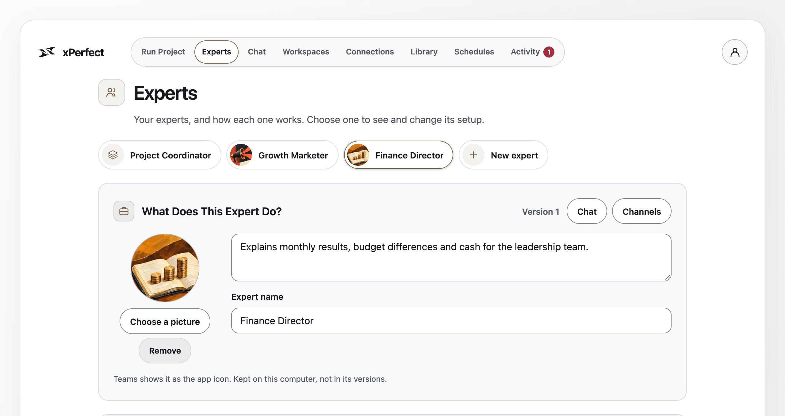
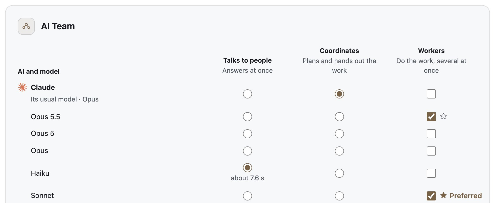
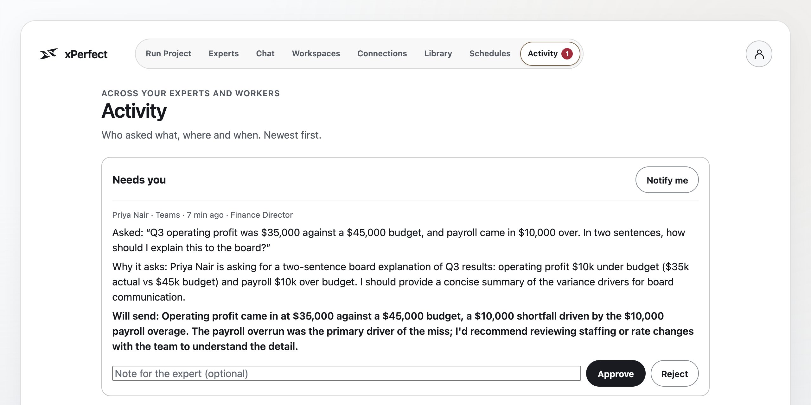
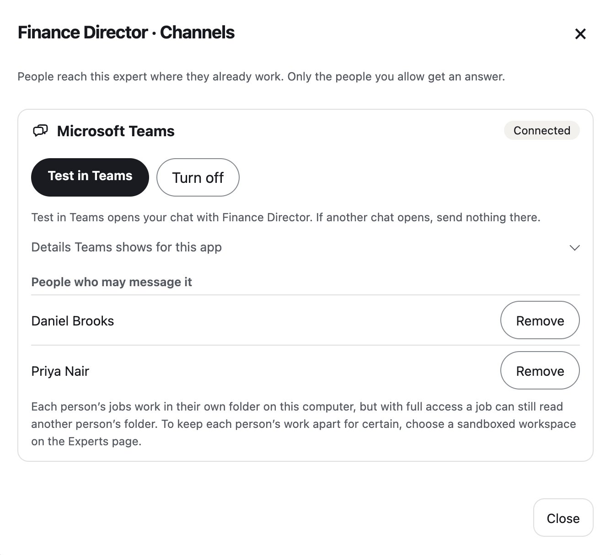

# Experts on channels

An owner makes an Expert (for example an AI version of their working self), gives it
instructions, and lets the people they choose message it where they already work, starting
with Microsoft Teams. A fast speaking assistant answers at once and hands work to a background
coordinator, which runs Workers in parallel. The owner can ask to approve what the Expert sends
or starts. This document owns the requirements; the [QA playbook](05_QA_Quick_Power_Playbook.md#11-experts-on-channels)
owns the acceptance cases.

Follow the [key principles](00_Key_Principles.md). Models own judgment: what to answer, what to hand
off and when to ask the owner. The runtime owns identity, holds, delivery and recovery. Nothing
matches words.

## What an Expert is

An Expert is the existing saved expert (a workspace template lineage). Its newest version is
current; every save makes a new version. The `expert` key in its content holds:

| Setting | Meaning |
|---|---|
| `instructions` | Who it is, what it does for people, what it must never share (the page calls them its **identity instructions**). The speaking assistant reads the newest text when each turn starts. A running job keeps the text it started with. |
| `team.talk` | The AI that talks to people (Claude or Codex), its model (its usual model, or any model the install's catalog has for that AI), its account, its effort and an optional backup. The page shows each model's median time to a finished reply on this computer. New Experts talk on Claude Haiku at low effort; a saved Expert keeps the model it was saved with, even one the list no longer names. |
| `team.coordinate` | The AI that runs each job, its model (its usual one unless chosen), its account and an optional backup. A chosen model runs at the AI's configured effort when that model offers it, otherwise at the model's recommended effort. |
| `team.work` | The Workers that may work on a job, in parallel. Each entry is an AI on its usual model (`codex-cli`) or one exact model of Claude or Codex from the catalog (`codex-cli:gpt-6.2-sol`); each becomes its own Worker route, named by the entry. Grok works on the model chosen for it in Connections. |
| `team.preferred` | Optional: one of `team.work`, the Worker the owner prefers. Its route comes first and the job's coordinator is told, in these words (the runtime prompt `prompts/expert-job-preferred.md`): "The owner's preferred helper for this Expert is the route `<entry>`. Use it for helper work unless another configured route clearly serves the job better." The coordinator still decides. Without it nothing is added, and an Expert saved before keeps its stored form and its routes byte for byte. |
| `ask_me_first` | `always`, `auto` (default) or `off`. |
| `workspace` | Where it works: this computer, where its Workers run with full access, or a sandboxed workspace, where its Workers run in containers and reach only that workspace. Saving any other level is refused; narrower permissions on this computer are a later capability. |

The Workers it may use (`team.work`) decide which Workers the job's coordinator can start. On this
computer (and everywhere on a packaged server install) a Worker runs on one connected, ready account of
its AI: the account chosen for that AI's role, else the default one, else the only one; with none, or
several and no default, the runtime refuses it. A sandboxed Worker on a local install is not held to
this. On this computer the coordinator still has its own AI's tools, so it can do the work itself when
no Worker can start; in a sandboxed workspace its own tools are off.

Knowledge and Skills stay in My Library and are referenced by exact version. An empty account
means this computer's own sign-in for that AI. Worker runs may share this computer's existing
Claude sign-in, up to the host's per-account limit (`WPR_HOST_ACCOUNT_ACTIVE_LIMIT`, 4 by default;
Workers of one AI are also capped at 3 at once by `WPR_HOST_MISSION_SLOTS_PER_CLI`): it copies no
credential, and each run uses the owner's own sign-in with a private config folder, the way several
Claude Code sessions share one sign-in. Setup, Verify and Disconnect still need it to themselves, and
a run whose stop was not confirmed keeps new runs out until it is recovered. Every other account,
whose credentials are placed in a run's own home, is leased to one Worker run at a time. A job also
runs in parallel across the AI types it may use. The speaking assistant's replies are not held by
those Workers on this computer's sign-in; a connected account cannot serve it and Workers together.

## The Experts page

The **Experts** tab, right after Run Project, shows one Expert's whole setup on one page in Run
project's style; Run Project's Edit and the "+" card in My experts open it. From the top:

- your experts as a row (each with its picture), and **New expert**;
- **What Does This Expert Do?**: the picture (Teams shows it as the app icon; kept on this computer, not
  in its versions), the description and the name; a saved one shows its version, **Chat** and **Channels**;
- **Identity Instructions**, in one box that grows with its text;
- **Knowledge and Skills**, chosen with Run Project's own searchable chooser;
- **AI Team**: one table. Each AI is one line for its usual model; its other models (newest first, from
  the install's catalog) open under it and stay open while one of them is chosen. The columns are the
  three roles, each said in a few words: **Talks to people**, **Coordinates** and **Workers** (any number;
  with several, a star marks the **Preferred** one). A click anywhere in a cell chooses it; the table is
  one keyboard stop with arrow keys between choices. An AI whose tool is not on this computer and that has
  no connected account says so, with a button to connect it. Where the runtime needs a connected account for
  Workers (see the paragraph under the settings table), the page asks it, for the place the Expert works
  in: an AI with no ready account says its Workers need one, and one with several and no default says to
  choose one; each line has a button to Connections, and Workers the runtime would refuse cannot be ticked
  (a saved one stays and can be unticked). Under the table: **Replies** (Quick or
  Usual) and **Accounts** (which sign-in each role uses, and who takes over at a limit);
- **Ask Me First**, then **Where It Works** and what it may do there;
- **Save** (a new version) and **Discard changes**.

Nothing on the page scrolls on its own: the page is the one scroll, at every width. Unsaved changes,
the instructions text included, are kept in the browser tab's own storage (session storage: only that
tab, gone when it closes), so a reload brings them back until they are saved or discarded; choosing another
Expert with unsaved changes asks in the page, never in a browser dialog. Run Project shows each
saved Expert's own picture on its card.

*A staged synthetic example on a local install, 25 November 2026. The time under Haiku is its median
measured on that install.*

## Three roles

- **The speaking assistant** has one conversation per person and per channel thread. With Claude
  it runs coordination-only: Claude Code's built-in file, shell, web and browser tools are off, its
  session is kept, and only its own four tools are allowed (`expert_hand_off`, `expert_jobs`,
  `expert_job_control`, `expert_ask_owner`, served at `/v1/native/expert`). It therefore reads no
  file itself and answers quickly. A Codex speaking assistant keeps Codex's own tools; this
  difference is stated where the AI is chosen.
- **Each hand-off is a job**: one background coordinator conversation with the coordinator's AI,
  routes for the allowed Workers, the Expert's Library, its instructions and its access level. The
  job's final answer is written once as a result event on the speaking assistant's conversation,
  and the existing result wake starts its next turn.
- **The hand-off's first words.** On a channel the speaking assistant gives `tell` with a hand-off:
  its whole reply to the person now (that the job started, and the answer to everything else in
  the message that it can give at once). They become one outbox message (kind `handoff`) in the same
  transaction that marks the job running, so the person hears them after one model step instead of
  two. The turn's own later text is then dropped; if the turn's text reached the outbox first, the
  words are dropped instead, so the person gets one of the two, never both. A job that never starts
  sends no words. On Always ask the words are part of what the owner approves: they are shown on
  the card and leave only when the approved job starts. Without `tell` nothing changes. The owner's
  own Chat has no outbox and is not affected.
- **Workers** are dispatched by that coordinator with the existing tools and run in parallel within
  the host's capacity. Each Worker carries the owner's instructions as its standing instructions,
  fixed when the job starts, whatever the coordinator writes in a dispatch. Coordinator-dispatched Workers are exempt from the manual one-project fence.

## Ask me first

One mechanism: what the Expert is about to send or start waits for the owner.

*A real reply held on Always ask, in the staged synthetic example, 25 November 2026.*

- A request shows exactly what waits: a reply with its text, or a job with its goal, plus who
  asked, where, when, and the Expert's reason.
- Approve releases that and nothing else: the runtime sends the reply that was shown, word for
  word, or starts the job that was shown.
- A changed or stopped job withdraws its request; an old approval then releases nothing.
- Reject is told to the speaking assistant in a turn with every native tool off; it writes its
  own reply, which goes out directly. The "checking with my owner" line in Always ask is written
  the same way. No sentence is scripted.
- **Off:** nothing waits. Instructions still apply.
- **Auto:** each incoming message carries who, where and when; the speaking assistant decides
  whether to call `expert_ask_owner`. When the AI provider's own safety check stopped part of a reply
  on a channel (a typed stop in that turn's native run), the stopped part may have been that call:
  the reply waits for the owner as in Always ask, and the person is told it is being checked. A
  stop in a job's coordinator or Worker changes nothing; on Off the reply is sent as it is.
- **Always ask:** the runtime holds two exits on channel conversations: a reply leaving to a person
  and a job starting. The owner's own Chat in xPerfect is not held: there the owner is the approver.
- Only a signed-in owner session decides (`POST /v1/expert-reviews/{id}/decision` requires the
  page's `human:confirm` assertion, on a local install too). A runtime token, a Worker's run
  authority or the Expert cannot approve. Waiting never approves.
- Requests appear on Activity under **Needs you**, with a count on the tab, a pop-up on any page
  and a browser notification when allowed. With more than three waiting, Needs you shows the newest
  three and one line **Show all N** that opens the rest in place; the count, the pop-up, each card and
  each decision are unchanged. Each Activity line that waits for the owner leads to its card.

### What this protects, plainly

On this computer with full access, the Expert's instructions and Ask me first are the guard. That
is a strong habit, not a wall: a Worker with full access can read what its OS user can read once a
job runs, and on one OS user it could also read xPerfect's own private files. Always ask controls
what is sent and started; it does not limit what an approved job reads. Before any second person
is added, extraction tests must show that the owner's personal material and another person's
private work cannot be obtained by asking, by tricking or through a job. Use a sandboxed workspace
or a server for a wall.

## Channels

- A channel binding names the Expert, the channel and the people who may write (by platform
  person id and tenant). Unlisted people get no answer and appear under **Waiting to be allowed**.
- Each incoming message is accepted once by the channel's own message id and becomes a turn in
  that person's conversation, framed with who wrote, where and when.
- Every outgoing message is saved in an outbox before a package sends it: `held`, `pending`,
  `sending`, `sent`, `not_confirmed`, `failed`, `dropped`. A send with no outcome after two
  minutes becomes `not_confirmed`, is shown to the owner and is never resent by itself.
- While xPerfect's disk guard holds runs (free disk under `WPR_HOST_MIN_AVAILABLE_DISK_MB`), an Expert cannot
  answer: Activity and each channel card say so plainly, with how many messages wait. They are answered
  once space returns; nothing is sent meanwhile.
- Turning a channel off stops its package and its jobs, drops its unsent messages and withdraws its
  waiting requests; accepted work stays visible. An approval never brings back a dropped message.
- Channel packages live beside the core and use only the channel routes:
  `/v1/channels/{id}/package`, `/heartbeat`, `/inbound`, `/deliveries/claim`, `/deliveries/{delivery}`.

### Microsoft Teams

*The Teams card of a staged synthetic expert, 25 November 2026. Its Connected badge reflects a local
stand-in for Microsoft's service, not a Microsoft connection, and its people were added directly, so
the owner is not listed.*

`integrations/teams` uses Microsoft's Teams SDK for Python (`microsoft-teams-apps` 2.2.1).

- **On this computer it uses Teams socket mode**: the bot dials out to Microsoft, so nothing on this
  computer is reachable from the internet and no tunnel is needed. Socket mode is marked
  experimental in the SDK and Microsoft recommends HTTP for production.
- **On a server** the package serves Teams' HTTP endpoint with `--http-port`.
- **Add Teams** on the Expert's **Channels** (Experts → the Expert → Channels; **Connect** when the code
  runs out) wraps the pinned Teams developer CLI (`@microsoft/teams.cli`
  3.1.0): the owner completes Microsoft's sign-in on Microsoft's own page with the code shown;
  the CLI creates a Teams-managed bot in socket mode and writes its secret to a private file in the
  state folder; the signed-in owner becomes the first allowed person; one package process runs per
  connected channel and survives runtime restarts. **Install in Teams** follows; **Test in Teams**
  only once a first message has come through (hurdle 9 below). The first version sends and receives text in personal chats; a message from a group chat or
  a team channel gets no answer, so no reply is read by people the owner did not list. Files and group chats are
  later capabilities; Teams file requests need a certificate, federated credential or managed
  identity (Microsoft, 20 November 2026).

An Expert may have a picture (**Choose a picture** under What Does This Expert Do?: any image, cut to a centred square at 192 by 192 in
the browser). It is kept in the install's state, not in the Expert's versions, and becomes its Teams
app's colour icon when the app is made and whenever the picture changes (the CLI's
`app update --color-icon`; the same picture is never sent twice). A refusal is shown on the card and
not retried by itself. Removing the picture leaves the icon Teams already has.

#### What Microsoft and Teams ask, and what xPerfect does

Found in the first connection to a real company tenant (24 November 2026). Each wall is said before
the person meets it, and xPerfect clears what Microsoft lets it clear.

1. **The work account is signed in elsewhere.** The sign-in shows a code to enter on Microsoft's own
   page, which works from any browser or a phone; the page says so.
2. **Microsoft may ask for a phone approval** in the middle of the sign-in. The page says so before
   it starts; the code lasts about 15 minutes, and Connect is offered again when it runs out.
3. **A brand-new bot is refused for its first seconds.** Microsoft answered 403, then 401 ("Socket Mode
   negotiate failed"), until the new registration had reached every region; the SDK treats both as
   final. The package tries again for about two minutes with growing waits, claims nothing and does
   not report itself online before the socket has held, and the card says **Connecting…**. A refusal
   that lasts is shown once, in Microsoft's words, until the socket holds. Restarts of a package that
   keeps exiting wait 5 seconds, doubling to 5 minutes; the owner's own action starts it at once.
4. **Teams asks web or desktop, and the add window may not appear the first time.** The card says
   either works and to press **Install in Teams** again.
5. **Teams does not let the person add custom apps.** Teams shows the add button greyed out and
   "Permissions needed. Ask your IT admin to add … to this team/chat/meeting." The person's own switch
   decides it, **Upload custom apps** in their app setup policy (Teams admin center → Teams apps → Setup
   policies; a new policy assigned to one person changes nothing for anyone else), together with two
   organisation-wide ones under Teams apps → Manage apps → Actions → Org-wide app settings → Custom
   apps: **Let users install and use available apps by default** and **Let users interact with custom
   apps in preview**. In the first real test both organisation-wide ones were on, and the one off was
   the person's own Upload custom apps. Before creating anything, Connect reads Microsoft's own report of both (the CLI's
   status) and, when either is off, creates nothing: the page names the switches and which is off,
   offers a note ready to send to the administrator (a first visit to the admin center can take up to
   30 minutes), and reads the report again by itself every two minutes. While a change spreads,
   Microsoft's report flipped between yes, no and no answer for more than an hour after the policy was
   assigned, even after fourteen yes in a row, and Teams' own add button lagged behind it too. So the
   report is only a hint: after a "no", the first clear yes for both switches creates the app (a missing
   or half answer is not a yes), and the card says "Microsoft may still be applying this. If Teams says
   Permissions needed, wait a few minutes and press Install again." The channel is ready only after a
   first message.
6. **What xPerfect cannot do with the CLI's sign-in.** The pinned CLI's sign-in asks only for Microsoft
   Graph `Application.ReadWrite.All` and the Developer Portal's `AppDefinitions.ReadWrite`. Assigning a
   policy (`teamsPolicyUserAssignment: assign`, documented for meeting policies), publishing to the
   organisation's catalogue (`POST /appCatalogs/teamsApps`) and installing for a person
   (`POST /users/{id}/teamwork/installedApps`) each need a permission it does not ask for. So the
   catalogue route has a sign-in of its own (item 14).
7. **The account that matters is not always the one expected.** Another login on the same computer
   may belong to another organisation (the CLI also reads the Azure command-line login). Connect
   always takes the Teams-managed route, never another login. When the CLI is already signed in,
   nothing is made before the page asks **Create it as …?** with the account and organisation ID
   Microsoft reported, or **Use another Microsoft account** (which signs the CLI out and shows
   Microsoft's code); the account is shown again while the app is made and on the card afterwards.
8. **Online is not ready.** The card says **Online · no message yet** until a first message has really
   come through, with the steps to add the app and write in its own chat; only then **Connected**.
9. **"Test in Teams" can open somebody else's chat.** Before the app was installed, the direct link to
   a chat with the bot opened an existing chat with another person. It is offered only once a first
   message has come through, with a line saying whose chat it opens and to send nothing in any other.
10. **Reading the Connect status never starts anything.** A finished sign-in creates the app once,
    however often the page reads the status.
11. **The app showed placeholder details** ("Developer" and example.com links) in Teams' install window.
    The owner sets the developer name, website, privacy and terms links on the card; xPerfect checks them
    by Microsoft's rules before sending anything and applies them with the CLI's `app update`.
12. **The CLI makes the bot for personal chats, teams and group chats** (its default when no scopes are
    given), while the Expert answers only in personal chats. Right after the app is made, xPerfect
    narrows it with the CLI's `app update --scopes personal`; a failure there is said on the card, and
    the app is never made twice.
13. **After an administrator adds the app** (published and pre-installed from the Microsoft 365 admin
    center, Agents → All agents → Add agent, with the audience limited to one person), Install in Teams
    still opens the developer copy, which stays blocked by the person's own policy; the CLI reports no
    catalogue state, so xPerfect cannot read it. The owner says "An administrator added it for me" once;
    the card then stops offering that link and says the app appears in their Teams by itself.
14. **An administrator's one press, while Teams refuses the app.** When the owner has chosen the Microsoft
    sign-in client for this route (`XPERFECT_TEAMS_ADMIN_CLIENT_ID`, a public client registration; none by
    default, and then the press is not offered), the card adds **Add <Expert> to my organisation's Teams
    apps**. Pressing it shows Microsoft's code. The administrator signs in on Microsoft's own page and
    approves what the setup may do; that consent is the yes. The sign-in asks for three Graph permissions:
    `AppCatalog.ReadWrite.All` (admin consent), `TeamsAppInstallation.ReadWriteForUser` (admin consent;
    the "Self" variant installs only the calling app itself) and `User.Read`. Then, by itself:
    - the press goes on only as the account the channel was refused for, or the one its app was made with,
      in that app's organisation (the CLI's sign-in is shared by the whole computer); another account gets a
      plain line naming both, and nothing reaches Microsoft or is made; the sign-in step names the account
      and organisation ID it is for;
    - nothing is made unless Microsoft granted `AppCatalog.ReadWrite.All` (a person who is not an
      administrator gets a plain line and the note for their administrator);
    - the app is made if it does not exist yet, and recorded at once as "not yet in the catalogue", so a
      later press resumes there and never makes a second app (an app made the usual way keeps its card as
      it is until it is in the catalogue);
    - the app's package goes into the organisation's catalogue (Graph "Publish teamsApp", no review), or
      the entry an administrator already added is found and reused;
    - it is installed for the person (Graph "Install app for user") only when the administrator signed in
      with the account that made it; another account adds it to the catalogue only, and the card holds the
      catalogue's link (`https://teams.microsoft.com/l/app/<catalogue id>?tenantId=<organisation>`);
    - an install refused while Microsoft spreads the new entry is tried again every 20 seconds for up to ten
      minutes, then left to that link.
    The card says what it makes visible: an app in the organisation's catalogue may be found by others as the
    organisation's settings allow (new custom apps follow the organisation-wide "Let users install and use
    available apps by default"), while only the people on the Expert's list get an answer. Narrowing who can see
    it is an administrator's step (Teams PowerShell `Update-M365TeamsApp`, or the admin center); no Graph call
    does it. To undo it, an administrator deletes the app in the Teams admin center (or Graph "Delete
    teamsApp"); "Uninstall app for user" removes it for one person. The token and the sign-in's device code
    live only in memory for that press: nothing writes them, and the card shows plain lines, never Microsoft's
    raw reply. An app already in the catalogue changes only by a new version there, so the card's details form
    says that saving there changes the app's own copy, not what Teams shows. For tests, the Microsoft addresses
    can be replaced only by addresses on the same computer (`XPERFECT_MICROSOFT_LOGIN_URL`,
    `XPERFECT_MICROSOFT_GRAPH_URL`).

15. **A signed-in browser can still be asked for the password.** The code sign-in is a fresh sign-in in that
    browser: in some organisations Microsoft asks for the account's password even though the browser already
    holds a session (in another, it asked only for a phone approval). Only the person types it; the code works
    from any device, a phone included, for about 15 minutes, and Connect makes a new one when it runs out.
16. **Microsoft's Teams tool keeps one sign-in for the whole computer.** It acts as the first account in its
    cache, and signing out removes every account. So **Use another Microsoft account** for a second organisation
    signs out the first organisation's sign-in: that Expert's Teams app keeps answering (each channel package
    uses its own app secret), but its setup actions (the app's details, its picture) need that organisation's
    sign-in again. One sign-in per organisation is a later capability.

## Nothing happens twice

- A job that has started is never started again by itself; it resumes or is reported.
- Stopping a job stops its coordinator conversation with the coordinator's durable Stop: nothing in
  it starts again, also after a restart, and other jobs are untouched. A finished Worker run wakes
  its job at once instead of waiting for the next pass over every conversation.
- A backup is another AI on this computer's sign-in. It is the conversation's armed fallback: the
  provider switches to it only before the reply starts, while the main route is in a quota or
  rate-limit cool-down. The owner sees each switch, and each reply a limit stopped with no backup,
  under Recent on Activity. Saving a backup the runtime cannot honour is refused: the same AI on a
  second account, or a main or backup on a connected account (the armed fallback switches the AI,
  not the account).
- A message delivered twice by a channel makes one turn. An outgoing message with an unknown outcome
  is never resent by itself.
- Backups, restores and upgrades review the Expert and channel tables like the other optional
  parts. A restored copy marks unsent or sending messages `not_confirmed`, so it never sends them
  again; it does not carry a channel's app secret, so a channel is connected again on a new machine.

## Known limits

- Skills reach Claude Code and Codex Workers on this computer and Workers in a sandboxed workspace.
  On a running install only Claude Code Workers on this computer have been seen using them; the
  Codex and container paths are covered by tests only.
- A conversation's AI and account are fixed when it starts; instructions, effort and Ask me first
  follow the newest version at each turn.
- This computer's existing Claude sign-in runs up to the per-account limit of Workers at once; any
  other account runs one Worker at a time, so parallel Workers there need several AI types or accounts.
  On one computer the host's Worker slots per AI tool come first (`WPR_HOST_MISSION_SLOTS_PER_CLI`,
  3 by default): one sign-in then runs at most 3 Workers at once in all, whichever person's jobs they serve.
- A backup on a second account of the same AI is a later capability. It needs the armed fallback to
  carry an account and cool-downs kept per account; on macOS a named second Claude account also
  needs local named-account support.
- When the AI provider's safety check stops a reply twice in one turn, Claude Code itself switches that
  session to another model and writes the rest with it (seen: Opus 4.8 for an Expert set to Opus 5.5),
  and says so in a typed `model_refusal_fallback` event. xPerfect does not ask for this. On Auto and
  Always ask that reply waits for the owner; on Off it is sent as it is, written by that other model.
  The switch ends with that turn: xPerfect passes the Expert's model on every turn, and a later turn that
  resumes the same session (which keeps the CLI's record of the switch) runs on the Expert's model again.
- A coordinator turn run again after a restart or a lost process cannot add goals once it has made
  some: it gets back the goals it already has, so the same work is never started twice under new names.
  A turn interrupted after making only some of its goals keeps those; the job's next turn can still
  start more.
- On this computer each person an Expert serves gets their own folder for its jobs
  (`<conversations' folder>/experts/<Expert>/<person>`, made at that person's first job, mode 700; the owner's
  own Chat has its own). The job's coordinator starts in it and its Workers on this computer work in it. With
  full access a job can still read other folders: this keeps people's work apart by default, it is not a wall.
  A sandboxed workspace is the wall.
- Slack, files in Teams, group chats and approving from inside Teams are later capabilities.
- A new Teams app starts with the CLI's placeholder details ("Developer", example.com links) until the
  owner sets the four under **Details Teams shows for this app** on the Channels card (Microsoft requires
  all four: HTTPS links with a domain and a developer name of at most 32 characters); xPerfect applies
  them with the CLI's own `app update`. A neutral default page of xPerfect's own is not decided yet.
- A Teams app is created for any organisation's sign-in (the CLI's default); creating it for one
  organisation (`--sign-in-audience myOrg`) waits until a fresh connection proves it with socket mode.
- A blocked Connect's re-check lives in memory: after a runtime restart, Connect is pressed again.
- One Teams-tool sign-in serves the whole computer: Experts of two organisations on one computer share it (item 16).
- Requests, approvals and outgoing messages carry text only: a file an Expert produces cannot yet be
  shown for approval or sent through Teams, and a message that is only a file is not read.
