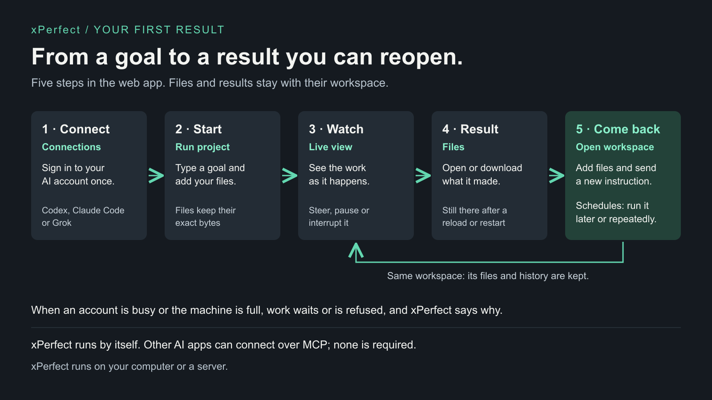
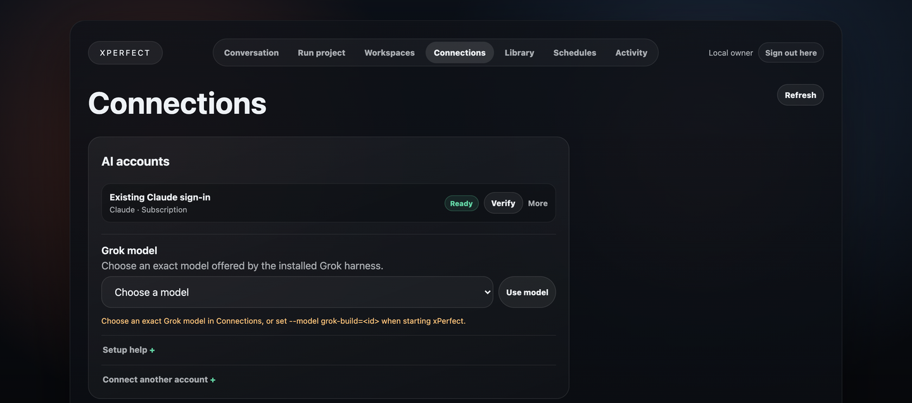
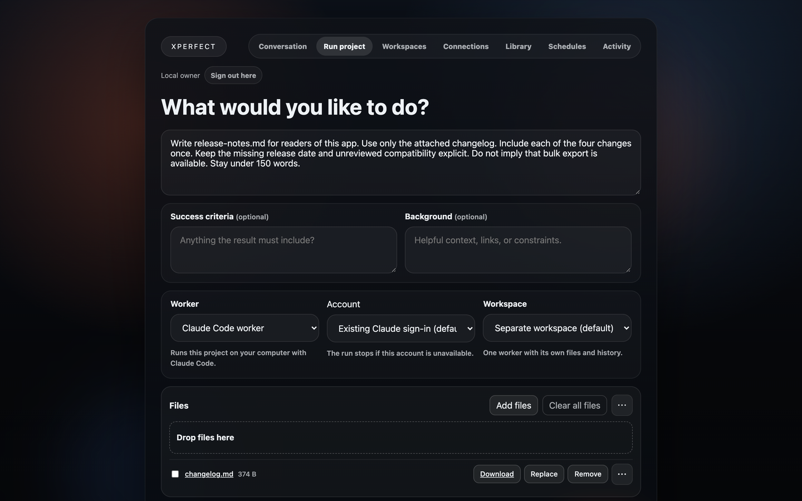
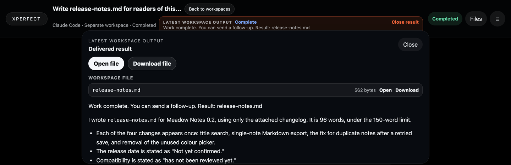
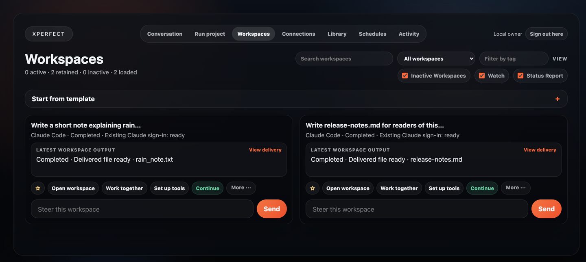

# xPerfect quickstart: your first result

[Visual user guide](https://www.xperfect.ai/docs/) · [Editable guide source](user-guide/README.md)

This walkthrough takes you from a fresh checkout to a finished result that you can open again
later. It uses the private web app on your own computer.



## On a hosted server

If someone hosts xPerfect for you, no local xPerfect install is needed:

1. Open their app address and sign in with the account they admitted.
2. In **Connections**, connect your AI subscription and wait for **Ready**.
3. In **Run Project**, choose that worker and account, describe the goal, and **Add files**.
   A ZIP can contain ordinary input files and a native skill folder. Ask the worker to unpack it;
   Codex uses `.agents/skills/<name>/SKILL.md`, Claude Code uses `.claude/skills/<name>/SKILL.md`.
4. Open **Watch** and its result. Use **Library → Files** to open or download outputs. Reload to check they stay.
5. In **Workspaces**, mark the expert as a favorite. Send a follow-up, or choose **More → Duplicate**
   for a separate copy. Files and native skills stay in the workspace; no extra skill router is needed.
6. In **Schedules → New schedule**, choose the workspace, instruction, time and time zone.
   Open the workspace after it runs and check the new result.

**Optional AI client.** **Connections → Use xPerfect from another AI app** provides native client
setup only when the deployment has a complete registration. The current hosted launcher does not
configure that registration; if setup is unavailable, the server operator must fix it. Connecting
your worker's subscription is a separate sign-in and does not connect your Codex/Claude MCP client.
Do not copy credentials or disable client approval to work around this.
See [MCP and serving an expert](developer.md) and [host the service](deployment-hosted.md).

The direct browser skill, follow-up and reload path passed on one hosted-mode Arm Linux test
server. This is not a full Internet deployment or external native-client onboarding pass.

## 1. What you need

- macOS or Linux, Python 3.11 or newer, and [uv](https://docs.astral.sh/uv/getting-started/installation/).
- Internet access. The first start installs dependencies, and the AI runs at your provider.
- The command-line tool of one AI provider you use, installed on this computer:
  [Codex](https://developers.openai.com/codex/cli/), [Claude Code](https://code.claude.com/docs/en/setup)
  or [Grok](https://github.com/xai-org/grok-build). [Account setup](host-setup.md) lists the tested versions.

## 2. Start xPerfect

From the repository:

```sh
./xperfect start
```

The first start asks you to choose an unlock password. Press Enter to have one made, and save it
in your password manager. Open the printed address, normally **http://127.0.0.1:8780**, enter the
password on **Unlock xPerfect** and select **Unlock**. This browser stays unlocked for 30 days.

`./xperfect doctor` prints a status report: whether the app is healthy, which AI tools it found,
and the exact model each one will use. Your saved work lives outside the checkout.

## 3. Connect your AI account

Open **Connections**.

- **Claude Code:** if you are signed in to Claude Code on this computer, select
  **Use existing Claude sign-in** under **AI accounts**. Nothing else is needed.
- **Codex:** under **Connect an AI account**, choose **Codex**, **My subscription** and
  **Connect Codex**, then **Open Codex sign-in** and enter the one-time code shown in xPerfect.
- **Grok Build:** under **Connect an AI account**, choose **Grok Build**, **My subscription** and
  **Connect Grok Build**, then **Open provider sign-in**. Grok also needs one exact model: choose it
  under **Grok model** in Connections and select **Use model**.

Wait until the account shows **Ready**. A running app is not yet a connected AI.



## 4. Start a project

The retained screenshots illustrate an earlier interface; the steps use the current labels.

Open **Run Project**.

1. Under **What's the Job?**, describe the work. **What's the required outcome?** is optional:
   use it for anything the result must include.
2. In **Required Knowledge**, add useful **Background Context**, use **Add files**, or select
   **Choose from Library**. A file name in the job is not an upload.
3. Under **Who's Doing The Job?**, keep **New**, then check **Worker type** and **Account**.
   Add a name if you want to find this worker again. **Existing** reuses a saved worker;
   **Copy an existing worker** under New starts from its files and setup. A same-owner copy can
   retain its selected ready account; new grants still need approval. It does not copy chat history
   or browser sign-ins.
4. Under **Where should I work?**, keep **New → My own workspace** for your first job.
   **Existing** offers only workspaces this worker can actually use. A saved worker keeps its
   existing location and account.
5. Select **Run Project**.

Try: “Write a short note explaining rain and save it as a text file.”



The workspace's live view opens. If the page stays on “Starting project...”, check **Workspaces**
before sending the job again. Your draft and any accepted job receipt stay available for recovery.

## 5. Watch and steer

The live view names the worker and shows its current work and latest output. Type in **Message
this worker** and select **Send** to redirect it now. To add a follow-up without interrupting,
hold **Send** or use **Cmd/Ctrl+Enter**.

Use the footer's **Pause**, **Resume** or **Continue** when offered. **More** contains the actions
available for this workspace, such as **Interrupt current run**. These controls affect this worker,
not the other workspaces.

If the AI asks for a response or permission, answer in its visible native controls. An unanswered
request can expire and stop that run. Check its status, then send a follow-up when ready.

## 6. Open the result

When the work is done, select **Open result** to read the answer. A delivered file offers **Open
file** and **Download file**. **Library → Files** lets you browse the workspace's other files.
Reload the page: the saved result is still there. It also survives `./xperfect restart`.



To keep a workspace file for another job, use its menu's **Keep for reuse**. It saves the selected
version privately in **My Library**. Removing a saved Library item does not delete the workspace's
copy. See [Library](07_Minimal_Unified_Operator_UI.md#one-library-across-the-app).

## 7. Come back to it

Open the saved worker from **Workspaces** and send a new instruction. It keeps its files and
history. To add more files, open **Library → Files → Add files**. Its existing tools can read
attached files; the prepared context list updates on the next start.



Use the workspace menu's **Rename** to change its display name. It remains the same worker with
the same files and account. To start a separate copy, use **Run Project → New → Copy an existing
worker**.

To run work later or repeatedly, open **Schedules → New schedule**, choose **Run a task**, select
the workspace, enter the job and choose when it should run. Select **Create schedule**. A one-off
workspace becomes saved when you schedule it.

## Good to know

- **Several goals at once.** In **Chat**, write them in one message. Choose a ready account that
  the page offers, or **Assistant on this computer** when available. Supported local host accounts
  can use Chat; a Linux container is not required for that local route. The page checks the actual
  deployment and installed AI tool before offering a choice. xPerfect tracks accepted goals and
  the AI decides whether to answer directly or hand work to a worker. Account limits and machine
  capacity still apply. See [several goals](capability-matrix.md#working-on-several-goals).
- **Own or shared workspace.** **My own workspace** keeps one worker's files and history separate.
  **Shared with other workers** offers **Common project files** or **Private files per member**
  on a configured Linux host. It is unavailable with `./xperfect start` on a Mac; keep **My own
  workspace** there. This shared-workspace limit is separate from local Chat support. See
  [workspace modes](02_Architecture_and_Components.md#workspace-file-placement).
- **Your computer or a server.** With `./xperfect start`, workers run on this computer as your
  user. On a hosted server, each workspace runs in its own container. Your files stay on your
  machine or server; your AI provider receives the task content it needs. See [deployment](deployment.md).
- **What a worker knows.** Its goal, the background and files you give it, its own built-in tools,
  and only the connections you allow. Change this in **Workspaces → More → Workspace settings**.
  See [context and tools](capability-matrix.md#what-each-worker-knows-and-can-use).
- **No other app needed.** xPerfect works on its own. Other AI apps can use it over MCP; see the
  [developer walkthrough](developer.md).

## If something goes wrong

| What you see | What to do |
| --- | --- |
| `doctor` reports a problem | Read the named private log, fix it, and start again. |
| “Connect an AI account to start.” | Connect an account in Connections and wait for **Ready**. |
| A run stopped with your provider's words, such as a usage limit | Follow them. Connections shows the message under that account until a later run completes. xPerfect never switches accounts for you. |
| “Queued” or “Waiting to start” | The account is busy or the machine is short of room. It starts on its own when that clears. |
| “Another project is already running on this computer” | Check **Workspaces** and wait for the work using the available slot to finish, then try again. The deployment's capacity decides how much can run at once. |
| A host resource message after **Run Project** | The machine is busy. Check **Workspaces** so you do not start the same work twice, wait a moment, then try again. |
| “Not enough storage for this file” | Delete files you no longer need, or ask your administrator to raise your limit, then **Retry**. |
| “Shared workspaces need xPerfect on a configured Linux host.” | Keep **Where should I work? → New → My own workspace** on this computer. |
| Chat offers no connected account | Read its setup message. Check that the selected AI tool is installed and the account is Ready in **Connections**. A deployment without a supported conversation route offers **Run Project** instead. |
| An account says “The exact native process was not confirmed stopped” | Wait until that workspace's run has ended, then select **Verify** in Connections. |
| The result is missing | Check the workspace's status and **Library → Files** before running it again. |

Use the same `--state-dir` for every command if you chose one. `./xperfect stop` keeps your
files, accounts and history. Interrupt running work before a planned stop; interrupted work does
not always continue by itself.

## Current limits

- Dragging files into or out of the browser has not been verified yet. Use **Add files** and **Download**.
- API-key sign-in has not been verified end to end yet. Use your subscription sign-in.
- **Duplicate** copies a workspace's files and native skill folders. A same-owner copy retains
  the selected ready account's authorized connection. Copies do not share private credentials
  between owners; a new owner must connect their own account.
- Shared workspace acceptance is bounded to the packaged Linux route. Local Chat and reuse of
  existing workers also have local acceptance; that does not certify every provider or deployment.

## Connect an MCP client

For local stdio, use the absolute path to `xperfect` as the command and `["mcp"]` as arguments.
Start xPerfect first. HTTP MCP is `http://127.0.0.1:8767/mcp` with its own private token. Never put
tokens in URLs, screenshots or Git. See the [developer walkthrough](developer.md).

More: [account setup](host-setup.md) · [capabilities](capability-matrix.md) ·
[deployment and recovery](deployment.md)


## Start with an expert

In **Run Project**, choose a ready-made professional, or use **My experts** for your own saved
expertise. Add the job, its required outcome and the company material they need. Check the AI
account and workplace, then choose **Run Project**. Review included native abilities when asked.
The same named AI Worker opens in Watch, where you can follow progress, steer the work and open
its actual results. Reuse that worker from Workspaces for the next job.

**Create my own** keeps the normal worker choices. Starting templates currently use Claude Code
on your computer; this does not change your default worker or account. Optional community tools
show their actual connection/setup needs. Company material stays in your private selection; it
is never added to the public starting package.
