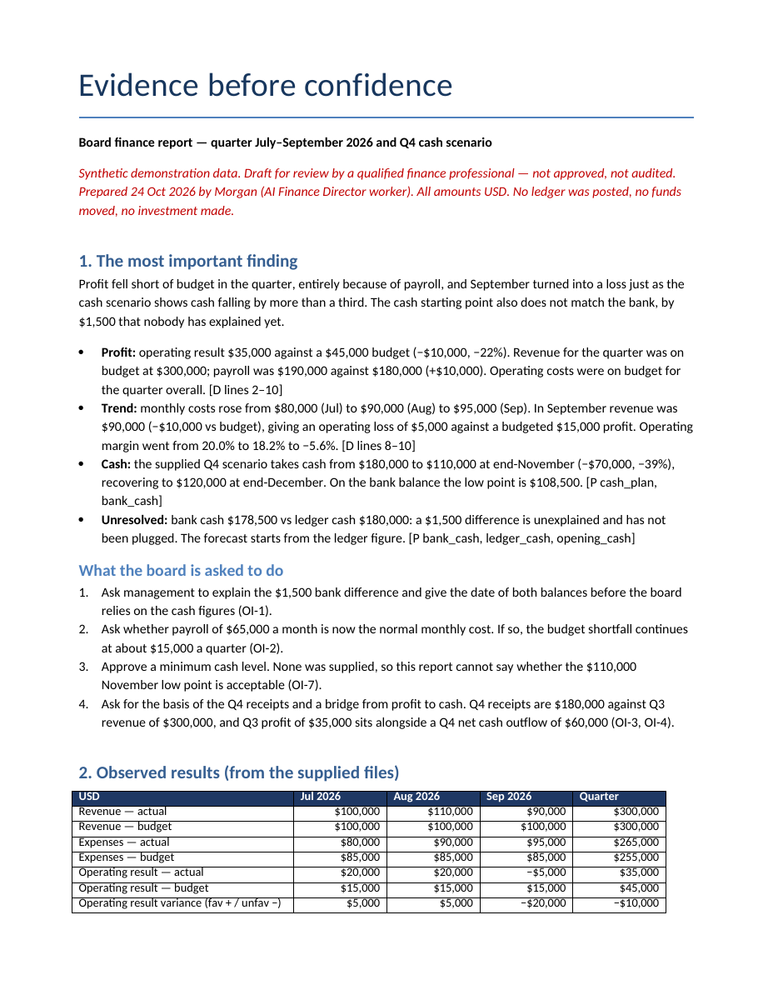

# Watch an AI expert do useful work

Choose a professional, give them the material they need, and inspect what they deliver.
This exercise uses an ordinary reusable xPerfect worker and synthetic data. No company or
customer information, external publishing or financial transactions are needed.

The main example is a **Finance Director** preparing a performance and cash review. The same
pattern applies to the other four starting experts below. For installation and account setup,
use the [quickstart](quickstart.md).

## Prepare the example

1. Open **Run Project → Experts → Finance Director**. Check **What's included** and connect a
   ready Claude Code account on the host. This is the starter's current native skill path.
2. Under **Background Context → Add files**, add these three files from the source folder:

   | Material | Purpose |
   | --- | --- |
   | [Company onboarding](../runtime_phase1/src/workers_projects_runtime/starter_packs/finance-director/demo/company-onboarding.md) | The company's reporting instructions and limits. |
   | [Monthly accounts](../runtime_phase1/src/workers_projects_runtime/starter_packs/finance-director/demo/data.csv) | Actual and budget figures to reconcile. |
   | [Planning assumptions](../runtime_phase1/src/workers_projects_runtime/starter_packs/finance-director/demo/plan.json) | Cash balances and forecast receipts/payments. |

3. Copy the [supplied job](../runtime_phase1/src/workers_projects_runtime/starter_packs/finance-director/demo/job.md)
   into **What's the Job?**. It asks for a board-ready review, editable calculations, a variance
   bridge and a cash scenario. It also requires uncertainty and unresolved differences to stay
   visible. Keep the account and workspace choices explicit.
4. Select **Run Project**. Review the included native abilities when asked. Optional community
   tools are separate; this example does not require silently installing or authorizing them.

The files and instructions above are the source of the example. The checks below describe
expected work; they are not a pre-generated report or a claim that every model run is correct.

## Follow the work

Watch shows the selected worker, progress and delivered files. Give direction in the same
workspace rather than creating another worker for each follow-up. If the native AI asks for
permission, answer in its visible controls.

Open the actual memo and calculation files with **Open result** or **Library → Files**.
Download the editable files. Check the figures and reasoning against the supplied inputs, then
reload and reopen that same workspace. The result should remain available without rerunning it.

## Inspect the result

The first page of an actual report produced from these synthetic inputs:

*Recorded 24 October 2026 from local Claude Code work using the bundled synthetic inputs.
The image is the first page of the downloaded report.*

| Check | Expected from these synthetic inputs |
| --- | --- |
| Quarterly operating performance | July and August each produce USD 20,000; September produces a USD 5,000 loss. The quarterly result is USD 35,000 against a USD 45,000 budget. |
| Cash reconciliation | Bank cash is USD 1,500 below ledger cash. The difference stays unexplained; the worker must not invent an entry to remove it. |
| Cash scenario | With the supplied opening cash and assumptions, month-end cash is USD 160,000, then 110,000, then 120,000. A forecast is not an observed result. |
| Traceability | Calculations and the memo identify their sources, units, assumptions and unresolved questions. |
| Useful delivery | The review is readable and calculations are editable. A filename in chat alone is not a delivered file. |
| Boundaries | No entries are posted, money transferred or investment decisions executed. |

The [fixture acceptance record](../runtime_phase1/src/workers_projects_runtime/starter_packs/finance-director/demo/acceptance.json)
keeps the numerical and quality checks beside their source. This demonstration does not establish
professional certification or replace review by a qualified finance professional.

## Change one assumption, then try bad input

**Follow-up:** ask the same worker to explain how an approved cash assumption changes the
forecast. Require it to keep the original inputs and distinguish the revised scenario from the
first one. Inspect the new files and confirm that the original result remains available.

**Unhappy path:** use the supplied
[bad-input.csv](../runtime_phase1/src/workers_projects_runtime/starter_packs/finance-director/demo/bad-input.csv)
in a separate disposable workspace. The expected behavior is a clear request for the missing or
corrected input, with the source preserved. The worker must not call an incomplete analysis
finished or invent values to make a report look complete.

To repeat the setup for another job, save it as an expert and start from **My experts**. To
continue this exact job, reopen its existing worker. Those are different actions.

## Try another profession

Each package contains its own job, synthetic inputs, company onboarding material and acceptance
checks. Use the same choose → onboard → run → inspect → follow-up pattern.

| Professional | Work to demonstrate | What makes the result useful |
| --- | --- | --- |
| [Clinical Biostatistician](../runtime_phase1/src/workers_projects_runtime/starter_packs/clinical-biostatistician/README.md) | Analyze a small study against its plan. | Response counts, uncertainty and missing participants remain explicit; no unsupported efficacy claim. |
| [Bioanalytical Scientist](../runtime_phase1/src/workers_projects_runtime/starter_packs/bioanalytical-scientist/README.md) | Reconcile assay exports and review QC exceptions. | The report links sample conclusions to calculations and flags what needs expert review. |
| [Regulatory Affairs Specialist](../runtime_phase1/src/workers_projects_runtime/starter_packs/regulatory-affairs-specialist/README.md) | Compare technical claims with source evidence. | Supported, conflicting and missing evidence stay distinct; no invented submission readiness. |
| [Growth Marketer](../runtime_phase1/src/workers_projects_runtime/starter_packs/growth-marketer/README.md) | Build a 90-day launch from a brand brief and channel results. | Usable campaign/copy drafts and measurement files separate observations from hypotheses; nothing is sent or published. |

The bundles are starting material for ordinary AI Workers. Your own company knowledge can be
added privately through the same Library and file controls. Optional external tools retain
their own connection, permission, dependency and license requirements.

## Use the same capabilities through API or MCP

Follow the [developer walkthrough](developer.md) to connect, discover the available tools, start
work, check its state, steer the exact worker and retrieve its results. Keep the returned worker
and run IDs; do not create another worker just to ask whether the first one finished.

Starting from a saved expert creates a fresh worker with that setup. Reusing a worker preserves
its own context and history. Neither route grants access to someone else's accounts or files.

## Before a live demonstration

Rehearse the exact release, deployment, account and skill route that you will present. Open the
result and download it, check representative figures, reload the workspace, and try the follow-up
and bad-input paths. Run `./xperfect doctor` before starting. Respect the
[current limits](../README.md#current-limits).

A recording must show actual work from its named release; label cuts that skip model execution.
If the live route fails, show a labelled rehearsed recording and explain the observed failure.
Do not present a mock, a setup screen or an architecture diagram as successful execution.

For a small connectivity check before the full exercise, the
[synthetic changelog](demo/changelog.md) remains available: ask the worker to preserve its four
changes in a short release note and keep the missing date and compatibility review explicit.
This checks connection and file delivery; it is not the professional-work demonstration.
